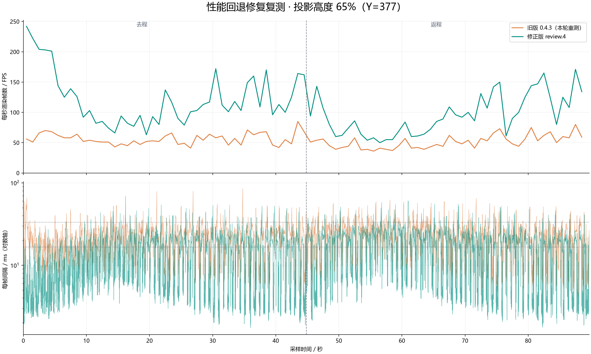
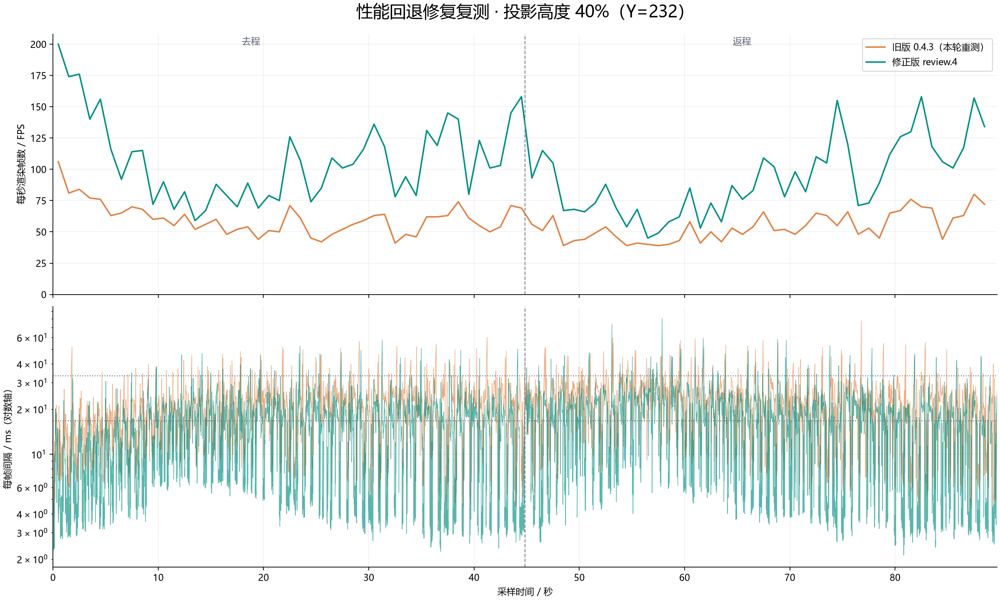

# 1.20.1 星空树投影性能对照

实验日期：2026-10-11（America/Denver；原始时间戳使用 UTC）。

本次比较 **BetterLitematica 0.4.3 与 0.4.4-review.4**，记录星空树投影在 65% 和 40% 高度、30 m/s 对角线往返时的逐帧表现。两个高度均观察到改善，但每高度每版仅一轮正式采样，结论限于本场景。此前性能回退和中间版本的数据一并保留。

- 基线源码：[54053b0](https://github.com/IMAX9D/BetterLitematica/commit/54053b0e010182f9cdd78aeab12897a5626d2dd3)。
- 修正版源码：[29cec78](https://github.com/IMAX9D/BetterLitematica/commit/29cec78741c4177b964167b0abb381b8d8bd6de6)。改动目前仅在 1.20.1 审查版本启用。
- 本实验双方都是 BetterLitematica；**没有测试独立 Litematica + litematica-printer，也没有测试实际打印吞吐**。打印关闭，打印参数保留为 0 / 0 / 0。

## 正式对照结果

| 投影高度 | 版本 | 帧数 | 平均 FPS | 1% Low / FPS | P95 / ms | P99 / ms | >50 ms 帧数 | 可见分区就绪率 |
| --- | --- | ---: | ---: | ---: | ---: | ---: | ---: | ---: |
| 65% | 0.4.3 | 4,849 | 54.04 | 18.01 | 34.09 | 47.98 | 40 | 89.73% |
| 65% | review.4 | 9,879 | 110.09 | 23.35 | 24.35 | 33.76 | 17 | 99.83% |
| 40% | 0.4.3 | 5,136 | 57.24 | 19.38 | 31.66 | 45.15 | 29 | 90.99% |
| 40% | review.4 | 9,005 | 100.35 | 23.33 | 24.09 | 34.17 | 12 | 99.80% |

65% 高度平均 FPS 增加 **103.7%**，40% 高度增加 **75.3%**。正式数据共 **28,869 帧**。表中百分比是本次测量结果，不代表所有机器、投影或高度都能得到相同提升。

| 投影高度 | 版本 | 测量期间分区构建数 | 网格页峰值 / MiB | 堆使用峰值 / MiB | GC 次数增量 | GC 累计耗时增量 / ms | 最长帧 / ms |
| --- | --- | ---: | ---: | ---: | ---: | ---: | ---: |
| 65% | 0.4.3 | 76,829 | 458.6 | 3,482.5 | 164 | 3,366 | 85.14 |
| 65% | review.4 | 29,776 | 733.8 | 3,473.5 | 165 | 3,328 | 68.82 |
| 40% | 0.4.3 | 76,551 | 766.2 | 3,495.3 | 180 | 3,444 | 77.48 |
| 40% | review.4 | 29,684 | 769.1 | 3,502.8 | 174 | 3,331 | 80.47 |

修正版保持更多网格就绪，65% 高度的网格页占用也更高；不能把本次结果表述为所有资源占用都降低。40% 高度的最长单帧仍稍差，改善主要体现在平均表现、P95 / P99 和长帧次数。网格页数值来自模组计数器，不等于整张显卡显存占用；堆与渲染状态峰值来自约每秒一次的采样，可能漏掉短暂峰值。

## 折线图

上图为每秒实际记录的帧数，不平滑；下图为每个渲染循环的间隔，使用对数纵轴。逐帧原始数值见数据包。

### 65% 高度（Y=377）

### 40% 高度（Y=232）

## 实验条件与计算方法

| 项目 | 设置 |
| --- | --- |
| CPU / GPU | Intel Core i5-13600KF / NVIDIA GeForce RTX 3080 10 GiB |
| 游戏 | Minecraft 1.20.1，Fabric Loader 0.18.4，Fabric API 0.92.2+1.20.1 |
| Java / 堆上限 | Microsoft OpenJDK 17.0.20.1+1-LTS / 4 GiB |
| 分辨率 / FOV | 1280×720 / 70 |
| 视距 / 模拟距离 | 32 / 5 区块 |
| 垂直同步 / 帧率设置 | 关闭 / 260 |
| 世界 | 相同初始模板的独立副本；平坦世界，种子 0，高度 1024 |
| 投影 | 星空树，809×580×726，放置原点 (-404, 0, -363) |
| 路线 | (-500, Y, -450) → (500, Y, 450) → 原起点 |
| 移动 | 30 m/s；视角朝移动方向，俯仰角 0 |
| 高度 | 玩家 Y=377 / 232；相机眼高约再加 1.62 |
| 预热 / 采样 | 静止预热 90 秒；完整往返约 89.7 秒，每帧记录 |
| 并行运行 | 一次只启动一个基准游戏 |

正式四轮的投影、游戏选项、Fabric API 和采样模组哈希相同，记录在各运行的 `manifest.json`。正式样本全程窗口有焦点，记录的移动速度为 30 m/s，玩家高度保持不变。

`interval_ns` 是相邻客户端渲染循环开始之间的间隔，单位纳秒；它不是显示器实际呈现间隔，也不是 GPU 单帧耗时。`work_ns` 是采样器记录的帧内工作时间。正式统计只采用 `phase` 为 `diagonal_outbound` 或 `diagonal_return`、且间隔大于零的记录，不含加载和预热。

- 平均 FPS = 1,000,000,000 / 全部有效 `interval_ns` 的算术平均值。
- 1% Low = 最慢 `ceil(帧数 × 1%)` 帧的平均间隔的倒数。
- P95 / P99 对排序后的帧间隔线性插值，索引为 `(N - 1) × 分位数`。
- 可见分区就绪率 = 测量期间逐秒 `readySections` 之和 / `visibleSections` 之和。没有网格的分区不算就绪；此指标不证明网格内每种材质均渲染正确。
- `duration_s` 来自采样器墙钟时间，与帧间隔累计值存在首尾边界差异；平均 FPS 始终按帧间隔计算。

## 修改内容与验证范围

修正版把同一世界区块整列的更新合并入队，每帧最多处理八列；真正队列溢出仍触发完整刷新，避免漏掉变更。1024 格高世界此前会把一列拆成 64 条通知，移动时容易反复触发全局刷新。正式修正版测量期间，全局刷新计数增量为零。

网格页恢复分档增长，同时按实际分配容量计入预算，保留任务与结果总量上限、取消中的任务占位、渲染线程生成的不可变模型快照，以及逐帧上传预算。调度器减少网格已就绪时被视角变化触发的无效扫描，也避免同一帧重复扫描已耗尽的任务列表。

另外为原版地形绘制加入空区段索引：一次世界绘制筛选一次完全空的区段，各地形绘制层复用结果，保留原始顺序和透明层逆序，下一次世界绘制重新生成。实体与遮挡列表不变。检测到 Sodium、Iris、Canvas 或 VulkanMod 时不启用此路径。本次高世界、大视距、空区段较多，不能把收益幅度外推到其他渲染器或普通高度的所有场景。

已完成以下验证：

- 最终修正版构建通过；本轮核心 135 项检查、2,467,430 条断言通过。
- 61 项真实 OpenGL 网格页检查通过。
- 16 项真实 Minecraft 类与 Mixin 环境检查通过，覆盖五种地形绘制层、正序与逆序、帧间增删、世界切换清理。
- 两个高度的真实游戏对照完成；正式四轮未发现投影网格生成、绘制或可见性相关异常。启动日志各有两条离线认证及模板 DragonFight 相关错误，因此不能描述为全部日志无错误。
- 40% 高度固定视角截图对照 review.3 / review.4：99.9923% 像素完全相同，平均每通道绝对差为 0.0000329 / 255，最大差为 6 / 255。仅核对了一个固定视角。

未在其他游戏版本、着色器或其他渲染器组合中进行这轮实测。以上检查分布在本轮开发阶段，最终 review.4 再次完成构建与游戏对照；没有因发布实验文档而重复运行整套游戏测试。

## 全部试验记录与限制

下表按开始时间排列，包含早期回退，避免只保留较好的结果。每次运行的逐帧文件与版本哈希都在数据包中。

| 运行 ID | 用途 | 平均 FPS | P99 / ms |
| --- | --- | ---: | ---: |
| initial-old-65 | 最初 0.4.3，65% | 61.56 | 44.33 |
| initial-new-65 | 最初 review.1，65%，回退 | 53.13 | 48.08 |
| initial-new-40 | 最初 review.1，40%，回退 | 53.69 | 45.52 |
| initial-old-40 | 最初 0.4.3，40% | 57.50 | 43.89 |
| review2-65 | 中间版本，65% | 51.21 | 49.73 |
| review2-40 | 中间版本，40% | 47.78 | 47.88 |
| baseline-65 | 正式旧版对照，65% | 54.04 | 47.98 |
| baseline-40 | 正式旧版对照，40% | 57.24 | 45.15 |
| review3-65 | 中间版本，65% | 56.07 | 46.28 |
| review3-40 | 中间版本，40% | 54.70 | 44.97 |
| review4-65-diagnostic | 受干扰的诊断轮，排除正式比较 | 106.62 | 35.47 |
| review4-40 | 正式修正版，40% | 100.35 | 34.17 |
| review4-65 | 正式修正版干净重跑，65% | 110.09 | 33.76 |

review.4 的第一轮 65% 采样开始时，与独立组件检查短暂重叠，因此完整重跑并使用后一次结果。该诊断轮的采样器总计数 9,565 包含一帧 `stationary` 过渡帧，按相同对角线阶段筛选规则得到 9,564 帧；两种计数均保留，并额外提供该轮未筛选的 `frames-all.csv`。正式四轮没有此计数差异。

正式旧版 65% 预热阶段录制过 30 秒 JFR，正式采样前已结束；review.2 的 40% 预热阶段也做过分析。review.4 的 40% 组件检查在预热阶段结束；最终 65% 重跑在测量期间没有此类检查。所有正式采样期间均未开启 JFR。

旧版 65% 的最初结果为 61.56 FPS，重测为 54.04 FPS，说明存在运行间波动；40% 两次为 57.50 / 57.24 FPS。本次未随机交错重复多轮，没有置信区间。多项改动累计应用，不能将全部提升单独归因于某一项。两版在移动期间就绪网格比例不同，这衡量的是实际移动查看体验，并非完全相同驻留几何下的纯绘制吞吐。

## 数据文件与校验

- [summary.csv](summary.csv) / [summary.json](summary.json)：正式四轮的主要统计。
- [detailed-summary.csv](detailed-summary.csv) / [detailed-summary.json](detailed-summary.json)：正式四轮的堆、GC、长帧、分段 FPS、构建计数等详细统计。
- [history.csv](history.csv) / [history.json](history.json)：全部 13 轮统计与排除原因。
- [measurements.zip](measurements.zip)：全部 13 轮，共 77,523 帧对角线阶段数据，约 4.75 MiB 压缩包。
- [manifest.json](manifest.json)：源码提交映射、帧数和压缩包内每个文件的 SHA-256。
- [SHA256SUMS](SHA256SUMS)：本目录公开资料的 SHA-256。

压缩包按运行 ID 分目录。每轮包括 `frames.csv`（逐帧纳秒间隔、位置、视角、焦点状态）、`samples.csv`（约每秒的堆、GC、服务端计数等）、`render-state.jsonl`（渲染状态）、`result.json`（原采样器结果）、`events.txt`（加载、预热、采样事件）及 `manifest.json`（版本和输入哈希）。仅上述诊断轮另有完整阶段的 `frames-all.csv`。

数据包不包含账号日志、启动凭据、本机路径、存档、模组二进制或用户提供的投影原文件，因此可复算已记录的帧时间指标，但仅凭公开资料不能完整重建该私人场景。

| 输入 | SHA-256 |
| --- | --- |
| 0.4.3 JAR | `1a8155ea54678cfc2349345baf7a4d360975d8b3d6c2eb138fab8c37cc9de505` |
| 0.4.4-review.4 JAR | `12d159054beaf3aff1af7219fcb25a0d645cfac84f7fe8b2a175750d6409842e` |
| 星空树投影 | `b67e199f858f9f183460ca3d919bc8afaee357824827702729c3d000a1eb2295` |
