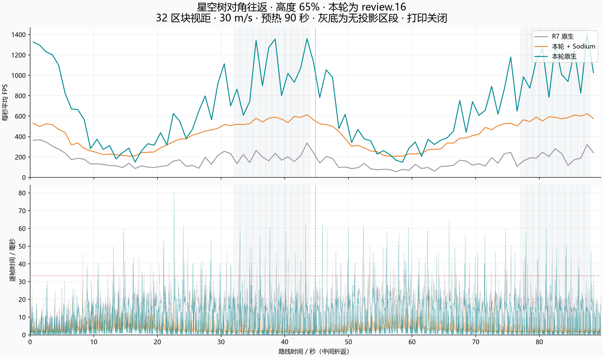
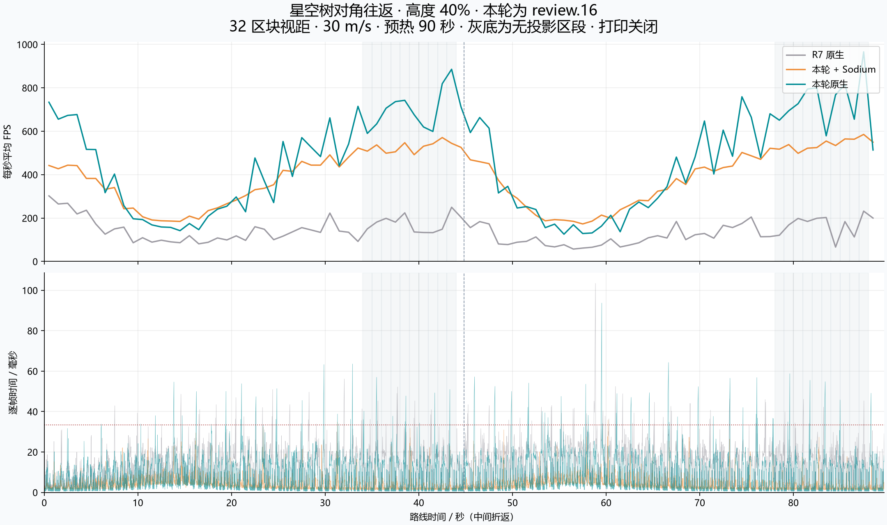

# 原生优化与 Sodium 对照（Minecraft 1.20.1）

2026-10-12。最终保留 **0.4.4-review.16**，基线为 R7（`085bb157be2104840bbf2cc419049a18ce4a61d4` 所对应的构建）。目标尚未完全达到：原生版全程平均 FPS 超过 Sodium 组合，但长帧明显更多，40% 高度的密集投影视角仍落后。

## 结果

“本轮原生”为仅安装 Fabric API、BetterLitematica review.16 和共同的测量驱动；“本轮 + Sodium”额外安装 Sodium 0.5.13。原生不包含 Sodium JAR。

| 高度 | 组合 | 平均 FPS | 1% Low | P99 / ms | >33.33ms | >50ms | GC / ms |
| --- | --- | ---: | ---: | ---: | ---: | ---: | ---: |
| 65% | R7 原生 | 166.71 | 26.76 | 28.80 | 99 | 5 | 3313 |
| 65% | R7 + Sodium | 416.02 | 89.16 | 8.21 | 2 | 0 | 931 |
| 65% | 本轮原生 | 706.78 | 40.59 | 17.95 | 84 | 25 | 3357 |
| 65% | 本轮 + Sodium | 419.58 | 87.82 | 8.08 | 5 | 0 | 981 |
| 40% | R7 原生 | 139.74 | 26.26 | 29.75 | 85 | 5 | 3281 |
| 40% | R7 + Sodium | 415.98 | 90.04 | 8.26 | 1 | 1 | 897 |
| 40% | 本轮原生 | 466.61 | 38.31 | 18.61 | 81 | 22 | 3055 |
| 40% | 本轮 + Sodium | 385.74 | 83.62 | 8.53 | 3 | 1 | 939 |

平均帧率相对 R7 原生明显提高，1% Low 也从约 26 FPS 升到 38–41 FPS；但 >50ms 的帧从每轮 5 帧增加到 22–25 帧。因此不能把本轮称为已经解决卡顿，也不能建议仅凭平均 FPS 就卸载 Sodium。

与本轮相同 JAR 加 Sodium 对比，原生 65% / 40% 高度的平均 FPS 分别约为 707 / 467，对方约为 420 / 386；P99 却约为 18–19ms，对方约为 8ms。更高的平均吞吐与更差的长帧同时存在。

## 密集投影视角

整体均值会受到空场景和较稀疏视角影响。额外按每秒可见区段采样选择两边均至少有 8000 个可见投影区段的完整秒，边界取前后相邻采样保守确认；此表是可见投影路段的子集，不能与其他分类相加。

| 高度 | 组合 | 共同密集区间 / 秒 | 平均 FPS | P99 / ms |
| --- | --- | ---: | ---: | ---: |
| 65% | R7 原生 | 16 | 98.54 | 37.76 |
| 65% | R7 + Sodium | 16 | 220.11 | 12.02 |
| 65% | 本轮原生 | 16 | 257.76 | 23.99 |
| 65% | 本轮 + Sodium | 16 | 228.94 | 11.29 |
| 40% | R7 原生 | 14 | 85.19 | 35.76 |
| 40% | R7 + Sodium | 14 | 209.84 | 10.71 |
| 40% | 本轮原生 | 14 | 165.23 | 24.37 |
| 40% | 本轮 + Sodium | 14 | 195.57 | 11.26 |

40% 密集区间中，本轮原生约 165 FPS，同版加 Sodium 约 196 FPS，较早的 R7 加 Sodium 约 210 FPS。原生优势并不覆盖所有施工视角。

## 折线图

上图是每秒内帧间隔均值的倒数，下图保留每帧时间，未平滑。灰底是两边可见区段采样均为零的保守区间；中间虚线为折返。图中绘制 R7 原生、本轮原生、本轮加 Sodium，较早的 R7 加 Sodium 保留在表格和数据中。

## 条件与计算口径

- i5-13600KF、RTX 3080 10 GiB；Java 17.0.20.1，4 GiB 堆；Fabric Loader 0.18.4、Fabric API 0.92.2+1.20.1、Sodium 0.5.13+mc1.20.1。
- 星空树投影尺寸 809×580×726，放置原点 (-404,0,-363)。文件 SHA-256 为 `b67e199f858f9f183460ca3d919bc8afaee357824827702729c3d000a1eb2295`。
- 32 区块视距，5 区块模拟距离，1280×720，FOV 70，关闭垂直同步，帧率选项为不限帧（配置值 260）。画质、环境光遮蔽、粒子、纹理级别等设置已核对一致。
- 玩家 Y=377 / 232，对应投影高度 65% / 40%。路线 (-500,Y,-450) → (500,Y,450) → 起点；30 m/s，朝移动方向，俯仰角 0。
- 使用相同初始世界模板的独立副本，世界高度 1024；每轮静止预热 90 秒，正式记录完整约 89.7 秒往返。一次只运行一个游戏。正式路线期间不编译或进行重型数据分析。
- **打印关闭**，打印参数保留 0 / 0 / 0。这是飞行查看投影测试，不是打印吞吐测试。
- 正式路线不启用 JFR。诊断轮单独使用 JFR，并有 NVIDIA 进程识别标记，未纳入任何正式性能表。
- 平均 FPS = 1000 / 平均帧间隔毫秒；1% Low = 1000 / 最慢 ceil(N×1%) 帧的平均间隔。分位数线性插值，长帧阈值为 1000/30 与 50ms。
- 逐帧时间来自 Minecraft 渲染循环，非显示器呈现时间。仅统计 `diagonal_outbound`、`diagonal_return` 且间隔大于零的帧；原始文件保留预热等阶段。`result.json` 的总计数可能多包含少量阶段切换帧。
- GC 为约 1Hz 采样首尾计数之差，不是精确覆盖整个正式区间。最终八条路线记录的未聚焦帧均为 0。
- 每个组合、每个高度只有一轮最终数据，未做随机交错的重复测量，不能推广为所有硬件、世界、版本或其他模组组合的结论。

## 保留的实现与兼容边界

1. 用向外遍历和角度裁剪替代原版远距离区段射线步进，减少对象和查询；规则来源见 [第三方说明](../../../THIRD_PARTY_NOTICES.md)。
2. 同一视角和遮挡图下，复用保守扩大的可见列表；移动超出余量、转向、视野变化、相机跨区段或遮挡图变化时重新计算。不会为了复用而缩小原版可见边界。
3. 缓存非空地形和方块实体区段列表；正常数据发布立即失效，兜底检查仍每 50ms 执行。重建候选列表按新脏标记更新，完成项及时移除。
4. 扩大后的区段边界框按原边界对象复用，避免重复创建。

仅修改 1.20.1 审查层。Sodium / Iris / Canvas / VulkanMod / OptiFabric 存在时整组原版地形钩子不加载；保留其他渲染器的配置。可用 JVM 参数 `-Dbetterlitematica.disableTerrainOptimizations=true` 手动关闭这组优化。

使用真实生产 JAR 与 Fabric Loader 0.18.4 检查了五个关键钩子：原生环境全部存在，Sodium 环境全部不存在。Sodium 0.5.13 完成两个高度路线。Iris、Canvas、VulkanMod、OptiFabric 仅设置避让，尚未实测。

共存性能也有单轮波动：65% 的 R7 + Sodium 与本轮 + Sodium 约为 416 / 420 FPS，40% 约为 416 / 386 FPS。未做交错复测，不宣称零性能回退。逐类比较显示，已有类只有兼容选择器与原版地形索引类发生变化；新增地形代码在 Sodium 环境未加载。此证据说明执行路径，不能替代重复性能测量。

## 诊断与淘汰记录

诊断采样中，渲染线程热点包括大量空区段的数据读取、视锥检查和重建候选遍历。另有大量数组分配来自世界区块保存序列化、光照映射复制，投影构建也有分配。`diagnostic-allocation-stacks.json` 保留独立 R14 诊断轮的采样估计；它不是最终版的精确分配计数，也不足以证明每个尖峰都由 GC 引起。

- review.11/12：无分配射线与正结果缓存，收益有限。
- review.13：方向/角度遍历，65% 约 218 FPS，仍低于 Sodium。
- review.14：NVIDIA 上下文标志未带来明确收益，已撤回。
- review.15：可见列表与地形索引缓存提高平均 FPS，但重复扩展边界框造成较多临时对象；长帧更差，未选用。
- **review.16：复用边界框并缓存重建候选，最终保留。**
- review.17：按需创建地形 GPU 对象，65% 约 721 FPS，相对 review.16 的约 707 FPS 变化小，长帧无明显改善；为减少干预已撤回。
- review.18/19：分散兜底检查，19 修正了完成项触发多余重扫的问题；实测仍未优于 16，额外逻辑已撤回。所有已开始的路线均完成；未开始的 Sodium 变体轮被取消，最终改用确切的 review.16 JAR 做共存测试。

所有完成实验的指标见 [experiments.csv](experiments.csv)，未删除较差结果。诊断轮不混入正式性能数据。

## 验证与交付

- 构建成功；恢复所选源码后再次构建，与实际测试的 JAR SHA-256 完全相同。
- 1014 项连续放置检查、97 项设置说明检查、35 个控件绑定、37 个停止原因 ID 检查通过。
- 实际 Minecraft/Mixin 加载环境中：24 个目标类加载通过；885 项遍历检查、480384 项视锥缓存检查、33 项地形索引检查通过。另有生产 JAR 原生/含 Sodium 的钩子存在性检查。
- 最终四条新路线全部完成。投影可见区段采样准备率约 99.83%–99.96%；这不是完整逐像素正确性证明。
- 与 R7 原生的固定视角预热截图比对：65% 仅 43 像素有差异，最大通道差 1；40% 为 65 像素，最大通道差 6。与 Sodium 的画面存在更大差异，已记录在 [visual-checks.json](visual-checks.json)。仅核对固定视角，没有对全部飞行画面、复杂真实建筑或其他模组组合做视觉验收。
- 未测试打印吞吐，未推广其他游戏版本。review.16 已替换到独立测试实例，安装后校验与实测 JAR 的 SHA-256 一致；实例中原有 Sodium 保留。

交付 JAR：`betterlitematica-fabric-1.20.1-0.4.4-review.16.jar`，SHA-256：`511093506b32f30662f602498f98002e5cc1ba24281fa9791fcb0d86f8caf4cf`。

数据：[summary.csv](summary.csv)、[summary.json](summary.json)、[区间统计](segments.json)、[验证记录](validation.json)、[逐帧原始数据包](raw-data.zip)。数据包不包含用户的原投影或存档。
