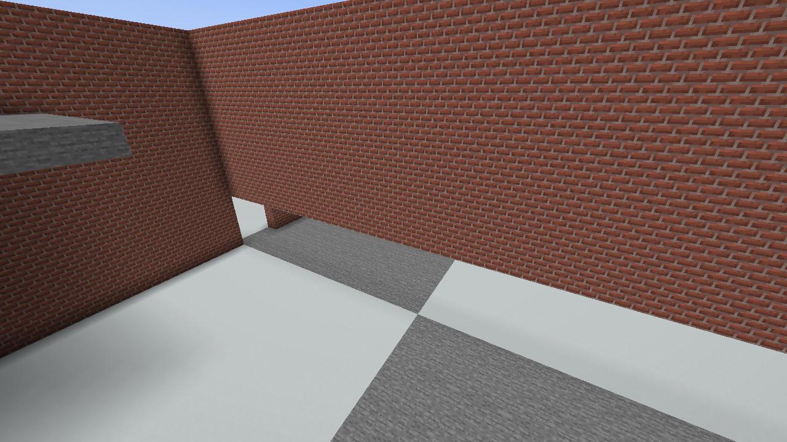
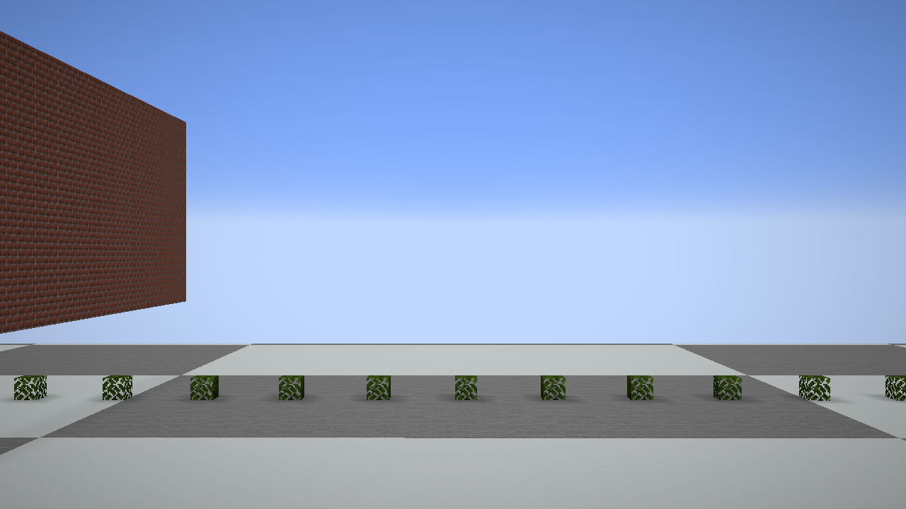

# 1.20.1 地形钩子复查

本页保留 review.22 的阶段记录。后续按用户要求修复并恢复了第 8 个遍历钩子，当前实现与验证见 [review.23 遍历修复](../2026-10-13-terrain-repair/README.md)。

2026-10-12，候选包 `betterlitematica-fabric-1.20.1-0.4.4-review.22.jar`。本轮只调整 1.20.1 审查覆盖层。

## 结论

原来的 8 个地形钩子中，撤掉 1 个遍历改写，修正后保留 7 个并默认启用。恢复原版遮挡遍历；投影自身的后台构建和暂存数组复用继续保留。构建、边界检查和独立游戏实例中的可见性对照通过。本轮没有重新测量星空树路线的帧时间，不能把旧版平均 FPS 沿用到本版，也不能据此宣称尖峰已解决。

## 逐项处理

| 原钩子 | 结论 | 依据与修改 |
| --- | --- | --- |
| `TerrainVisibilityGraphMixin` | 删除 | 它取消原版远距离检查，又增加向外方向及主轴角度排除，不是原版遍历的等价替换。删掉钩子与 `SectionVisibilityGraph`；加载后的 `collectRenderableChunks` 与原版 388 条指令一致。 |
| `TerrainChunkInfoAccessor` | 保留 | 只读区段引用；生产 JAR 的目标与字段映射已验证。 |
| `TerrainFrustumAccessor` | 保留 | 只读矩阵与位置；不改变原版视锥计算。 |
| `TerrainVisibilitySetAccessor` | 保留 | 只读原版发布的集合；缓存不修改源集合。 |
| `TerrainFrustumCacheMixin` | 修正保留 | 原来只比集合身份和大小，现在逐项比对象、顺序和不可变边界框引用；投影矩阵、相机分区、有限坐标均需一致。先捕获、原版遍历完成后确认再提交；期间换集合或移动视锥即放弃缓存。强制视锥、自定义视锥、异常数值回到原版路径；切世界及重载均清空。 |
| `TerrainLayerIndexMixin` | 修正保留 | 不再跨帧保留类别索引；同帧再用也核对区段及数据引用，区段数量相同的替换/重排不再漏掉。每次重查重建候选，删除 50ms 缓存窗口及 `TerrainDirtyUpdates`。保持透明层逆序和只有方块实体的区段。 |
| `TerrainDataClearMixin` | 修正保留 | 清空发布必定使索引失效；边界框更换时重算扩展框，原框不变时复用。移除不再需要的脏标记字段写入钩子。 |
| `TerrainDataPublishMixin` | 修正保留 | 每次原版发布数据都失效，不再只检查类别变化。未经过它的直接数据替换也由列表的引用校验捕获。 |

启用决策在插件加载时一次性确定，保证读取器和使用它们的钩子整组加载或跳过。`-Dbetterlitematica.disableTerrainOptimizations=true` 仍可禁用整组；检测到 Sodium、Iris、Canvas、VulkanMod、OptiFabric 时跳过。

## 验证

- 构建通过；构建自带的 1,014 项连续放置检查、设置完整性检查通过。
- 无窗口的真实 Mixin 变换检查共 971,211 次断言，其中包含 **480,000 组**原版 `Frustum.isVisible` 对照：不同坐标（含接近正负世界边界）、方向、俯仰、FOV、宽高比及有界平移。它验证扩展框结果是原版可见结果的超集；不是独立游戏场景数量。
- 900 轮区段列表变更，逐层对比原版筛选结果；覆盖替换、重排、发布、直接写入、脏/干净变化、方块实体与透明顺序，以及强制视锥、未完成捕获和重载清理。
- 生产 Fabric Loader 0.18.4 + Fabric API 0.92.2 的类加载验证：原生 7 个钩子启用，手动禁用和真实 Sodium 0.5.13 都整组跳过。另 4 个渲染模组仅用了同名测试元数据验证门控，**未安装实际 Iris/Canvas/VulkanMod/OptiFabric 进行游戏验收**。
- 独立游戏实例使用真实 Minecraft 1.20.1、Java 17、候选 JAR 和外置校验模组；没有修改用户测试存档。本轮没有加载投影，专门验证真实地形。
- 游戏共 **4,111 次**视锥应用对照，累计 **17,408,979 次**原版可见区段检查，遗漏或顺序错误 **0**。自然缓存命中 921 次，额外固定视角重放命中 406 次；这两类计数分开保存。
- 场景覆盖墙角、室内屋顶、玻璃、水、树叶、悬空箱子；快速转头与上下看、跨区段移动、方块及箱子增删、FOV 30/110、视距 8/12/32、远处传送并返回、渲染器重载、退出后进入另一存档。完整流程自动结束并正常保存退出。

原版后台可能在一次调用期间发布新的集合，本次记录到 4 次。校验必须对照这次遍历真正读取的集合；缓存命中时还核对稳定发布期间的当前集合。早期校验拿调用前的旧集合与随后新集合按对象身份比较，曾误报；诊断记录确认当时 `reused=false, graphChanged=true`。修正校验后才统计本报告的数据。另修正了测试辅助模块的包名和退出顺序，辅助模块不进入交付 JAR。

## 场景记录

## 边界与复现记录

这轮是正确性核对，不是性能对照；外置校验有额外遍历开销，其帧率不能作为性能结论。未覆盖所有显卡、所有渲染模组及其他游戏版本，不能保证任意组合都没有问题。Iris/Canvas 等仍保持跳过策略。继续调查尖峰时应使用没有外置校验模组的同配置路线。

结构化结果与门控范围见 [validation.json](validation.json)。完整辅助源码、日志、启动清单、旧误报记录及本轮截图保存在本机 `output/terrain-audit-20261012`；未将测试模组打进正式 JAR。

候选 JAR SHA-256：`2f09cd6521aa36b3595c8c3d8277801614a493d5bf60e9636fe9b6bc7b7427d0`。用户现用测试实例仍保留原来的 review.20，尚未替换；本轮尚未推送 GitHub。
