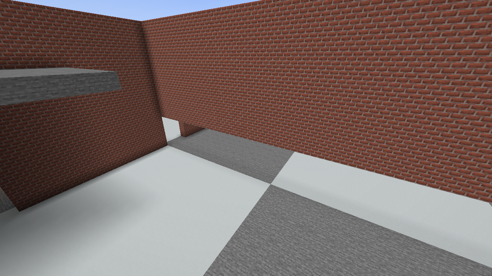
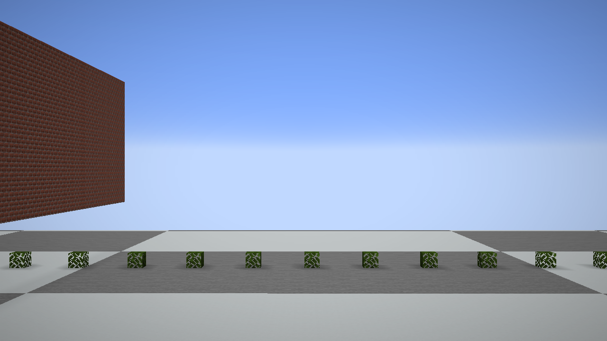

# 1.20.1 遍历钩子修复

2026-10-13，`betterlitematica-fabric-1.20.1-0.4.4-review.23.jar`。只调整 1.20.1 审查覆盖层。

## 交付结果

按“修复并保留”完成：**8 个地形钩子全部保留，原生渲染时默认启用**。`TerrainVisibilityGraphMixin` 已恢复注册，实际执行优化；不是空钩子，也不需要实验开关。review.22 撤掉整个遍历钩子的处理已被本轮替代。其他 7 个钩子的缓存失效修复保留。

本轮改变了遍历优化的实现：不再依赖未经完整证明的“只能向外走”和“仅允许主轴穿过对面”的近似裁剪，也不直接取消原版远距离检查。保留原版候选队列、方向连接、阻挡条件、采样点、世界上下界及 60 格停止条件，优化这段检查的执行成本。

- 采样循环使用基本数值和可复用坐标，不再每一步创建 `Vec3d`、`BlockPos`。
- 同一轮只缓存已经成功的路径；失败路径会随已访问区段增多重新检查。
- 复用键核对相机、起点、实际步长、存储对象、图对象、世界和几何修订；修改步长或距离输入不能误用旧结果。
- 区段移动期间停止复用；移动前后修订不同则重新采样。世界变化、重载、新一轮遍历均失效。
- 缓存限 65,536 个角点，遍历结束释放暂存向量和世界引用。两处原版遍历入口以及区段移动入口都使用 `finally` 清理，异常也不会遗留有效缓存。
- 仍整组跳过 Sodium、Iris、Canvas、VulkanMod 和 OptiFabric；保留 `-Dbetterlitematica.disableTerrainOptimizations=true`。

## 对照验证

### 源码与构建

检查原版 1.20.1 的实际遍历字节码、两个调用入口及区段移动入口；修复只替换远距离采样循环，不额外裁掉邻接边。review.23 构建通过，构建内连续放置 1,014 项及设置完整性检查通过。开发类加载使用 Loader 0.15.0，生产 JAR 的变换及游戏运行使用 Loader 0.18.4；没有提高既有 Loader 依赖下限。

### 独立参考实现

原版参考保留 `Vec3d.add`、`subtract` 和 `BlockPos` 的原始采样方式，不调用修复版 sampler。

- 120,000 组随机射线 + 600 组边界用例：结果与每一步坐标/顺序一致。
- 90,000 组缓存对照：逐步扩大的已访问集合、同一角点重复使用、失败后重试，结果与原版一致。
- 检查步长变化、输入距离变化、图/存储/世界替换、区段移动、嵌套移动、跨轮失效、缓存上限及线程隔离。
- 额外重跑此前其余地形钩子的 971,219 次断言，包含 480,000 组视锥对照和 900 轮列表变更。

### 真实游戏中的抽样对照

独立实例完成快速转向、俯仰、墙角与屋顶、玻璃/水/树叶/箱子、FOV 30/110、视距 8/12/32、增删方块、传送、渲染器重载、退出并进入另一存档。正常保存退出。

修复后的远距离检查实际执行 **3,382,975 次**；按约 1/64 抽样，**52,871 次**与原版循环对照，差异 **0**。几何移动导致输入不稳定的抽样数为 0。此外做了 **4,077 次**视锥应用对照、累计 **17,270,809 次**可见区段检查，遗漏或顺序错误 **0**。

此处统计重复判断次数，不是独立区段数量。外置校验模组不进入交付 JAR；本轮验证真实地形，没有加载星空树投影，不是帧率压测。

## 局部性能

每种实现均使用相同的 98,304 条射线工作量。4 轮预热，9 轮测量，轮换执行顺序；表内为中位数。工作量包含同一轮对 4,096 个角点的三次访问，8 次独立遍历。分配量使用 JVM 当前线程分配计数器；不包含三组共同的输入构造。

| 实现 | 时间 | 临时分配 | 区段查询次数 |
| --- | ---: | ---: | ---: |
| 原版对象采样循环 | 4.953 ms | 58,519,488 B | 1,462,968 |
| 等价标量采样 | 2.849 ms | 768 B | 1,462,968 |
| 等价采样 + 同轮复用 | 4.089 ms | 768 B | 483,544 |

完整修复路径相对原版循环耗时下降约 **17.5%**，循环内临时分配由约 58.5 MB 降到不足 1 KB。单纯标量化在这个低成本模拟查询中更快；复用减少了查询次数，但自身也有开销，不能据此宣称复用在所有场景都更快。

这是算法微基准，查询器为受控模拟输入，**不能换算为整场 FPS、1% Low 或帧时间尖峰改善**，也不能沿用 review.16 的高平均帧率作为本版成绩。后续整场性能需要无校验模组的同路线复测。

## 兼容性边界

生产 JAR 验证确认 8 个钩子存在并在原生路径启用；手动禁用和真实 Sodium 0.5.13 时整组跳过。Iris/Canvas/VulkanMod/OptiFabric 仅检查了同名测试元数据下的跳过逻辑，没有实际安装它们进行游戏验收；不将其标为完整兼容已验证。

本轮未推广其他游戏版本，未替换用户现用测试实例，未推送 GitHub。尖峰问题仍不能视为全部解决。

## 场景及数据

结构化记录见 [validation.json](validation.json)。完整测试辅助源码、构建日志、原始输出和截图在本机 `output/terrain-repair-20261013`；测试模组没有打入交付文件。

SHA-256：`8a1425a66b75306c2f04f68d7022a41bf8b2668bda6065fa603293cdf18a5375`。
