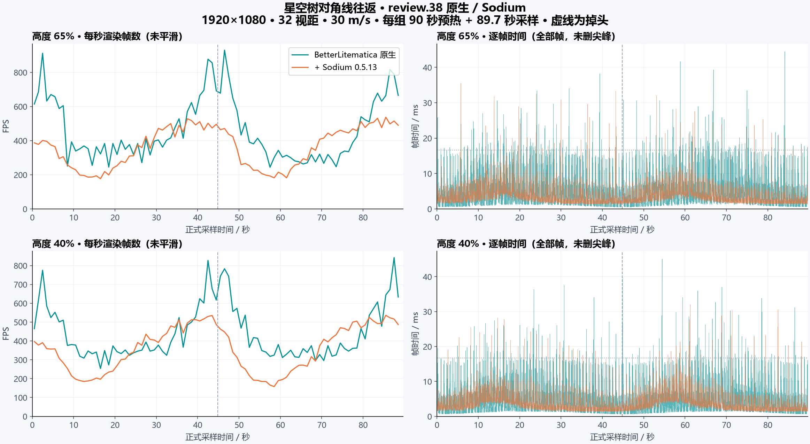

# 可见区块遍历与 Sodium 对照

本轮仅修改 Minecraft 1.20.1。原版地形可见性流程已由独立编写的六面连通广度搜索取代，沿用此前的专用构建线程、区域缓冲和分段上传。没有内嵌 Sodium，也没有复制其源代码；参考范围见 [第三方说明](../../../THIRD_PARTY_NOTICES.md)。

最终构建为 **0.4.4-review.38**。本机路线的全程平均 FPS 高于 Sodium 组合，但中央密集区域仅领先约 4%–8%，P99 和长帧数量仍落后，不能据此称为全面超越 Sodium。

## 实现范围

- 遍历使用数组队列、按列保存的邻接步长、进入面合并和向外搜索；距离和视锥检查发生在继续搜索邻居之前。没有历史实验的主轴角度裁剪。
- 在视角矩阵不变、相机仍处于同一区段且位移不超过保守边距时复用候选。旋转、跨区段、环形存储重定位和世界切换会重新计算。
- 视野外遮挡更新先核对当前候选，避免无条件重走整张图。前方尚未加载的边界列也记为依赖，加载后立即重新搜索。
- 开通新的可视路径立即重算。仅关闭路径时，旧结果仍是保守超集，允许暂时多画，200 ms 内合并剔除；新增方块和深度遮挡并不延迟。
- 已构建、完全可通视且没有几何或方块实体的原版空区段共享不可变结果；它与“尚未构建”哨兵不同。存在几何、方块实体、不透明连通关系或自定义数据类型时保留原结果。
- 正常数据发布、清理和新重建请求立即使相关缓存失效。大候选集合额外每 50 ms 完整核对一次，以发现绕过正常发布入口的直接数据替换；小集合逐帧核对。
- 不透明层使用共享绝对索引批量提交，修复此前批量绘制在实际游戏中出现的光照不一致。透明层保持区段与索引顺序，在共享缓冲绑定下依次提交。

模型、流体、光照、32 字节顶点格式和资源包着色器仍使用 Minecraft/Fabric 接口。没有实现 Sodium 的压缩顶点、完整模型渲染器、实体/粒子优化及驱动兼容系统；此实现不能称为 Sodium 的完整等价重写。

## 测量方法

使用用户提供的星空树投影，实际帧缓冲 1920×1080，32 视距，模拟距离 5，FOV 70，关闭垂直同步，不限帧。每组独立启动、使用相同的新鲜世界副本，90 秒定点预热，随后以 30 m/s 从 `(-500, Y, -450)` 到 `(500, Y, 450)` 并返回，视角朝向行进方向，俯仰角为 0。每组完整路线约 89.7 秒。分别取投影高度的 65%（Y=377）和 40%（Y=232）。

测试世界高度为 1024，以容纳完整的 580 格高投影；这高于原版世界，扩大了区段存储量。只有投影，没有把星空树建成实体。打印关闭，保存的打印参数均为 0/0/0。因此本轮是投影飞行与原版地形遍历对照，不是生存施工吞吐量测试。

每个高度比较同一个 BetterLitematica JAR 与同一 JAR 加 Sodium 0.5.13；后者跳过全部原生地形 Mixin。运行时为 Java 17、Fabric Loader 0.18.4、Fabric API 0.92.2+1.20.1，堆上限 4 GiB。正式采样不启用 JFR，不并行运行其他游戏或构建任务。两个高度交换测试顺序，避免总由同一组先运行。

每帧记录游戏渲染循环起点间隔；它不是显示器实际呈现时间。平均 FPS 为总帧数除以这些间隔的总时长；1% low 为最慢 1% 帧的平均间隔的倒数。P99/P99.9 使用线性分位数。图中的 FPS 按秒计数且不平滑，帧时间保留每一个完整落在正式采样窗口内的间隔。

每组有一个起始间隔横跨预热截图与正式采样（`elapsed_ns < interval_ns`），其中包含截图开销，未计入正式统计。筛选仅按时间边界，不按耗时；排除记录另存为 `boundary-intervals.json`。原始 `frames.csv.gz` 仍完整保留预热、边界和正式记录，没有删除任何原始数据或正式窗口内的离群尖峰。

## 实测结果

硬件为 i5-13600KF、RTX 3080、32 GiB 内存。下表中平均 FPS 与 1% low 越高越好，P99 帧时间与长帧次数越低越好。每行是一整趟独立运行，不是多次运行的均值。

| 高度 | 组合 | 平均 FPS | 1% low | P99 / ms | 超过 33.33 ms | 超过 50 ms |
| --- | --- | ---: | ---: | ---: | ---: | ---: |
| 65% | BetterLitematica 原生 | 464.4 | 55.9 | 14.48 | 7 | 0 |
| 65% | 同版 + Sodium | 364.2 | 79.5 | 8.88 | 1 | 0 |
| 40% | BetterLitematica 原生 | 444.0 | 56.7 | 13.56 | 9 | 0 |
| 40% | 同版 + Sodium | 360.3 | 80.1 | 9.08 | 0 | 0 |

全程平均领先约 27.5% / 23.2%，但包含路线两端较空的画面。单独取中央一半路径（相机 X 在 -250 至 250 之间，两次经过均计入）后，差距明显缩小：

| 高度 | 原生平均 FPS | Sodium 组合平均 FPS | 原生 1% low | Sodium 组合 1% low |
| --- | ---: | ---: | ---: | ---: |
| 65% | 329.9 | 318.3 | 49.4 | 70.4 |
| 40% | 340.3 | 315.4 | 50.5 | 71.0 |

所以平均吞吐量已接近或高于对照，间歇性卡顿仍需改善。用户回忆的 100 / 300 FPS 是另一个手动观察值，本次路线没有复现相同倍数，不能据此否定那个场景，也不能把路线平均值当作任意固定视角的帧率。

帧时间图中的横向点线为 16.67 ms；纵向虚线为掉头。所有正式帧均保持前台焦点。按每秒可见区段统计，投影网格就绪比例约为 99.79%–99.94%；这只是采样点的加载覆盖率，不证明每一帧都没有加载空缺。

完整数据见 [summary.csv](summary.csv)、[summary.json](summary.json) 和 [data/](data/)；各组包含逐帧压缩 CSV、每秒统计、运行参数、模组/投影/设置哈希及边界间隔记录。[SVG 图表](fps-frametime.svg) 可用于放大查看。

### 早期候选与波动

早期 review.37 的同条件 65% 高度对照为原生 **316.9 / 39.0 FPS**、Sodium 组合 **258.0 / 56.7 FPS**（平均 / 1% low），原始数据保留在 [earlier-candidate/](earlier-candidate/)。Sodium 组合本身也明显波动，因此不能把 316.9 → 464.4 的全部变化归因于代码。本轮没有足够的相同构建重复样本来估计稳定收益区间。

结构性变化可以从计数核对：同一路线中，完整遍历由 2367 次降至 1042 次；遍历累计耗时由 15.69 s 降至 4.97 s。前者主要反映合并关闭路径更新后的工作量变化，后者同时受运行时状态影响。此前 720p / JFR 诊断及窗口实际为 1920×1061 的运行不混入这张正式对照表。

## 验证与边界

- **源码与构建**：只更新 1.20.1 覆盖层；JDK 25 构建生产 JAR，通过编译及打包。Java 17 下运行，JAR 不含 Sodium 类或嵌套 JAR。其他游戏版本未推广。
- **语义检查**：157991 项断言通过，覆盖多角度视锥、负坐标、世界高度外视角、环形存储、重载、空区段、方块实体、封闭墙、立即开洞、关闭路径的 200 ms 清理、直接数据替换及前方区块加载。使用真实 Minecraft/Fabric 类，检查程序不打包到模组。
- **离屏 GL**：3036 项检查通过，覆盖缓冲/索引、上传与回收、透明顺序及光照输入；显卡为 RTX 3080。
- **真实游戏画面**：10 个视角各拍摄开启/关闭遮挡的画面，并与同一场景先前记录的原版渲染对照。包括室外四面、室内、正负区块边界、俯视、世界顶部/底部之外及中途重载。8 个视角与原版逐像素一致，另一个仅 4 个像素相差 1 色值；含水面的视角平均每通道差 0.013/255，超过 8 色值的 167 个像素位于水面。未在这些场景发现地形缺失或此前的整体光照变暗。结果不能推广为所有地形或模组组合都无差异。

[画面原件及逐像素统计](visual/) 和 [验证记录](validation.json) 一并保存。正式 JAR 的 SHA-256：`200994995facf81dc3ba538415aa8a57da8ae546dc02a1d8f4b5c0fcee1178f2`。

Sodium 共存通过实际游戏运行检查。Iris、Canvas、VulkanMod、OptiFabric 仍仅确认检测后跳过整组地形钩子的策略，未做这些组合的完整实测；不能把跳过钩子等同于兼容性验收。
