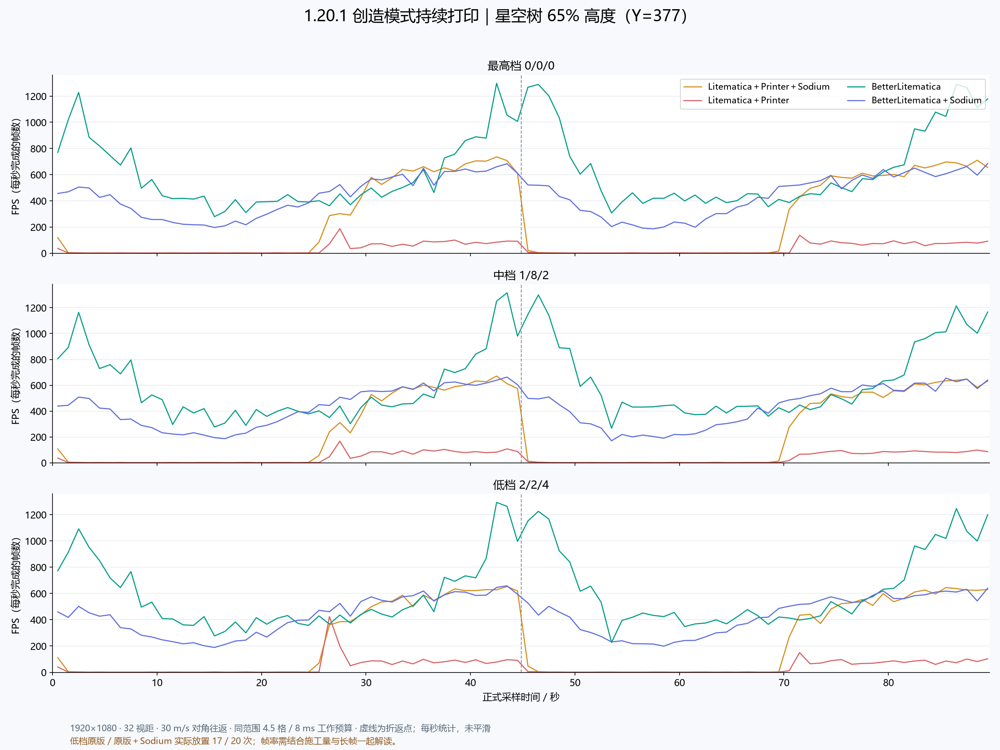
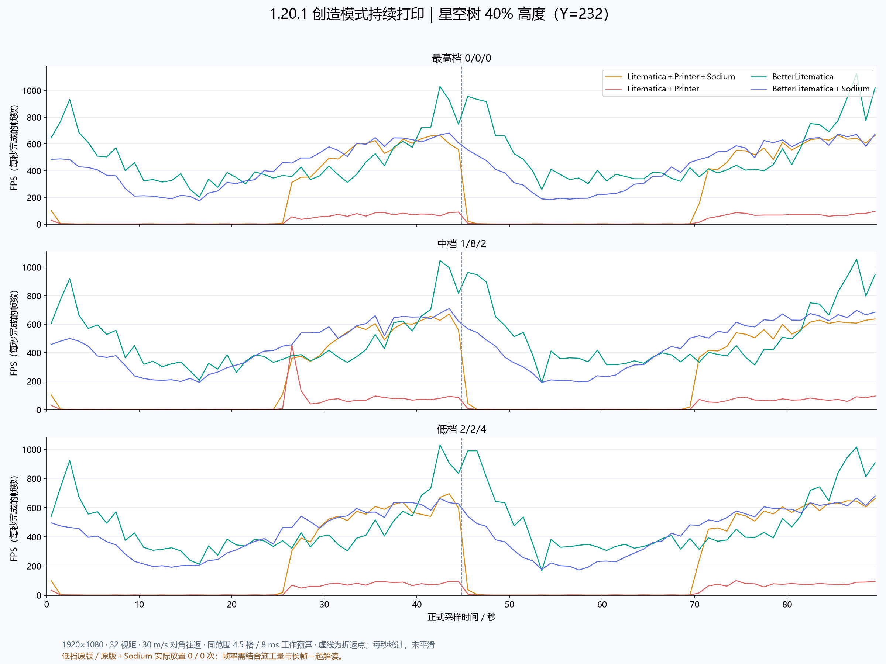
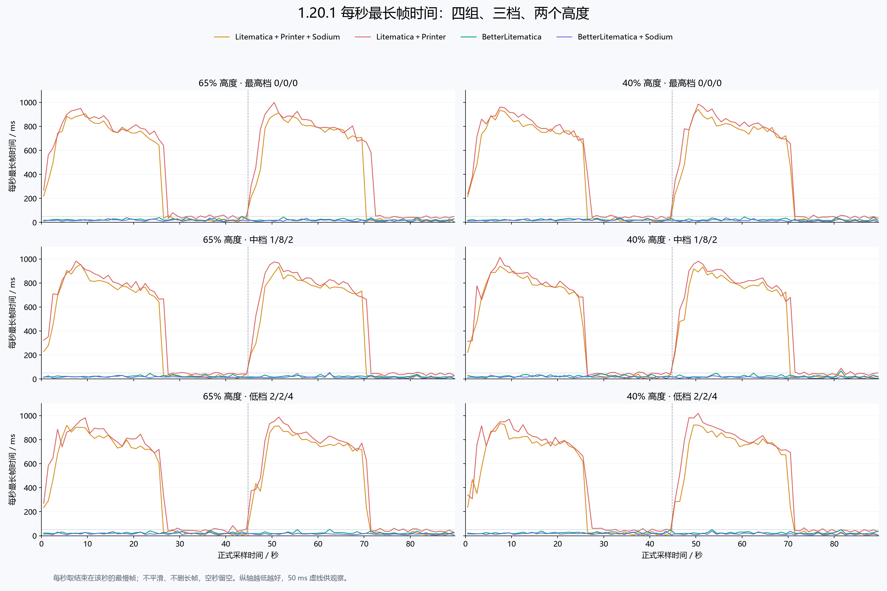
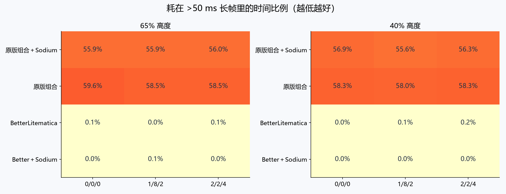
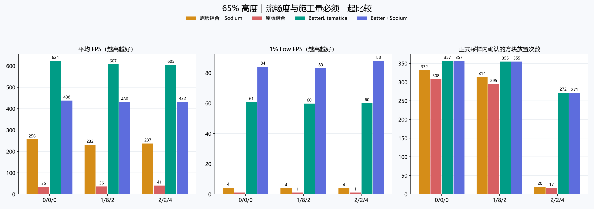
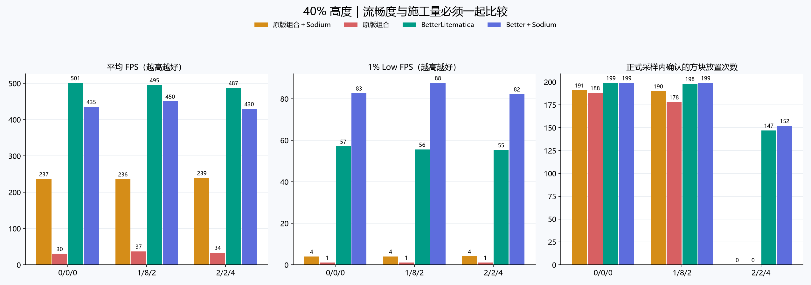

# Minecraft 1.20.1 持续打印对照测试

> 历史测试：被测 BetterLitematica 为 0.4.14。文中的“等待推广”描述当时进度；当前 0.4.17 已完成 31 版本源码推广和构建。
测试目的：先验证已有完整渲染优化的 1.20.1，再由用户决定是否推广。全版本推广暂停；本轮未修改被测模组或用户常用测试实例。

## 结论与推广建议

**已有优化值得继续做跨版本适配；当前还不能称为全面超过 Sodium。** 原生 Better 在本轮六个高度/档位组合中的平均 FPS 均高于 Better＋Sodium；Better＋Sodium 在这六个组合中的 1% low 均更好。平均更快与更稳定是两项不同的结果。

- 最高档原生 Better 在 65% / 40% 高度分别约 624 / 501 FPS，1% low 为 60.8 / 57.1；Better＋Sodium 为 438 / 435 FPS，1% low 为 84.1 / 82.7。
- 更密集的中央区域，40% 高度 Better＋Sodium 约 377 FPS，高于原生 Better 的 360 FPS，1% low 也更好。原生组两端空视野的高帧率提高了全程平均值。
- 原版两组最高档最长帧约 0.91–1.00 秒；Better 原生约 46–51 ms，Better＋Sodium 约 36–38 ms。明显长停顿减少，但十几到几十毫秒的短尖峰仍存在。
- 低档原版施工异常：65% 高度原版 / 原版＋Sodium 只放置 17 / 20 次，40% 高度均为零。对应 Better 原生为 272 / 147 次，Better＋Sodium 为 271 / 152 次。不能把少施工或不施工时的 FPS 作为同等施工量的优势。
- 这些数字不是同游戏版本的旧 Better 与新 Better 对照，不能单独量化某一个优化的贡献。它们证明的是当前完整 1.20.1 版本在这四组组合中的实际表现。

建议先将已验证的异步网格、分页绘制和刷新策略适配到 1.21.1，再按相同流程复测。验收同时检查中央区域、1% low、每秒最长帧时间、显示完整性和实际放置数；达到要求后再覆盖其余 API 家族。当前保持暂停推广，等待用户审阅。

本轮使用 1024 格高的自定义测试世界，每条件只跑一次。普通存档、其他硬件和其他版本不能直接套用这些帧数。

四种组合 × 三档参数 × 两个高度，共 24 趟。每条件一次，全部逐帧数据保留，短跑预检不计入正式结果。

共分析 680,266 个正式帧间隔，覆盖 35.87 分钟正式采样；每趟另有 90 秒预热。

## 最高档结果

| 高度 | 组合（0/0/0） | 平均 FPS | 1% low FPS | P99 / ms | 最长帧 / ms | >50 ms 长帧占时 | 实际放置次数 |
|---|---|---:|---:|---:|---:|---:|---:|
| 65% | Litematica＋Printer＋Sodium | 256.2 | 4.4 | 9.60 | 911.45 | 55.88% | 332 |
| 65% | Litematica＋Printer | 34.7 | 1.2 | 786.99 | 999.14 | 59.56% | 308 |
| 65% | BetterLitematica | 623.7 | 60.8 | 11.95 | 51.13 | 0.06% | 357 |
| 65% | BetterLitematica＋Sodium | 438.2 | 84.1 | 8.42 | 36.39 | 0.00% | 357 |
| 40% | Litematica＋Printer＋Sodium | 236.6 | 4.0 | 9.26 | 941.33 | 56.88% | 191 |
| 40% | Litematica＋Printer | 30.4 | 1.1 | 818.76 | 984.64 | 58.29% | 188 |
| 40% | BetterLitematica | 501.2 | 57.1 | 13.46 | 45.51 | 0.00% | 199 |
| 40% | BetterLitematica＋Sodium | 435.5 | 82.7 | 8.70 | 38.05 | 0.00% | 199 |

## 相同高度和参数的组间差值

正值代表 Better 的 FPS 更高。差值应与实际放置数量和长帧指标一起解读，两套渲染算法的透明表面处理并不相同。

| 高度 | 参数 | 对照 | 平均 FPS 差值 | 1% low 差值 | 放置数量差值 |
|---|---|---|---:|---:|---:|
| 65% | 最高档 0/0/0 | BetterLitematica 对 原版组合 | +1695.1% | +5182.2% | +15.9% |
| 65% | 最高档 0/0/0 | BetterLitematica 对 原版组合＋Sodium | +143.5% | +1284.1% | +7.5% |
| 65% | 最高档 0/0/0 | Better＋Sodium 对 原版组合＋Sodium | +71.1% | +1815.2% | +7.5% |
| 65% | 中档 1/8/2 | BetterLitematica 对 原版组合 | +1577.9% | +5091.0% | +20.3% |
| 65% | 中档 1/8/2 | BetterLitematica 对 原版组合＋Sodium | +162.2% | +1402.6% | +13.1% |
| 65% | 中档 1/8/2 | Better＋Sodium 对 原版组合＋Sodium | +85.6% | +1985.3% | +13.1% |
| 65% | 低档 2/2/4 | BetterLitematica 对 原版组合 | +1385.1% | +5079.8% | +1500.0% |
| 65% | 低档 2/2/4 | BetterLitematica 对 原版组合＋Sodium | +155.1% | +1374.9% | +1260.0% |
| 65% | 低档 2/2/4 | Better＋Sodium 对 原版组合＋Sodium | +82.0% | +2060.0% | +1255.0% |
| 40% | 最高档 0/0/0 | BetterLitematica 对 原版组合 | +1547.5% | +4938.4% | +5.9% |
| 40% | 最高档 0/0/0 | BetterLitematica 对 原版组合＋Sodium | +111.9% | +1319.7% | +4.2% |
| 40% | 最高档 0/0/0 | Better＋Sodium 对 原版组合＋Sodium | +84.1% | +1957.2% | +4.2% |
| 40% | 中档 1/8/2 | BetterLitematica 对 原版组合 | +1231.6% | +4756.0% | +11.2% |
| 40% | 中档 1/8/2 | BetterLitematica 对 原版组合＋Sodium | +109.8% | +1261.9% | +4.2% |
| 40% | 中档 1/8/2 | Better＋Sodium 对 原版组合＋Sodium | +90.7% | +2048.5% | +4.7% |
| 40% | 低档 2/2/4 | BetterLitematica 对 原版组合 | +1342.9% | +4789.5% | 不可计算（基准为零） |
| 40% | 低档 2/2/4 | BetterLitematica 对 原版组合＋Sodium | +103.5% | +1252.8% | 不可计算（基准为零） |
| 40% | 低档 2/2/4 | Better＋Sodium 对 原版组合＋Sodium | +79.4% | +1911.0% | 不可计算（基准为零） |

## 中央区域（最高档，|X|≤250）

该统计单独取靠近投影中央的路线，减少两端空视野高帧率的影响；仍保留区域内所有长帧。

| 高度 | 组合 | 中央区域 FPS | 中央区域 1% low | 中央区域 P99 / ms |
|---|---|---:|---:|---:|
| 65% | Litematica＋Printer＋Sodium | 170.0 | 2.6 | 15.43 |
| 65% | Litematica＋Printer | 27.1 | 1.2 | 791.44 |
| 65% | BetterLitematica | 422.2 | 53.1 | 15.02 |
| 65% | BetterLitematica＋Sodium | 380.1 | 75.6 | 9.57 |
| 40% | BetterLitematica | 359.6 | 51.1 | 15.87 |
| 40% | BetterLitematica＋Sodium | 377.3 | 74.0 | 9.87 |
| 40% | Litematica＋Printer＋Sodium | 156.7 | 2.3 | 15.42 |
| 40% | Litematica＋Printer | 21.3 | 1.2 | 828.08 |

## FPS 与每秒最长帧时间

[查看对数刻度版本，放大较短尖峰](charts/每秒最长帧时间-对数.png)

每秒最长帧时间按帧间隔的结束时刻分桶，无有效帧的秒留空，不补零。FPS 折线按每秒帧数统计。所有折线未经平滑，所有长帧保留。

## 优化路径与视距核查

Better 的每趟运行必须实际产生后台网格和投影页才能通过验证。Litematica 的运行时渲染状态含 D:32，服务器日志也记录视距切换到 32；不是只检查配置文件。详细记录见 render-audit.csv。

起点 (-500,Y,-450) 距离投影包围盒中心约 670 格，32 区块名义距离约 512 格。起点截图只显示附近部分投影，不能据此判断视距未生效。短跑与正式预热后，原版起点同为 D:32、无待构建队列。

| 条件 | 后台完成网格 | 最大投影页数 | 全局刷新累计 |
|---|---:|---:|---:|
| 03-65-high-better | 31234 | 299 | 0 |
| 04-65-high-better-sodium | 31409 | 297 | 0 |
| 05-40-high-better | 31430 | 309 | 0 |
| 06-40-high-better-sodium | 31531 | 309 | 0 |
| 10-65-medium-better | 31279 | 298 | 0 |
| 11-65-medium-better-sodium | 31394 | 297 | 0 |
| 13-40-medium-better-sodium | 31577 | 309 | 0 |
| 16-40-medium-better | 31483 | 309 | 0 |
| 17-65-low-better-sodium | 31438 | 300 | 0 |
| 18-65-low-better | 31259 | 299 | 0 |
| 23-40-low-better-sodium | 31535 | 308 | 0 |
| 24-40-low-better | 31510 | 309 | 0 |

## 条件与控制变量

- 使用前次相同的星空树文件，809×580×726；SHA-256：`b67e199f858f9f183460ca3d919bc8afaee357824827702729c3d000a1eb2295`。原点 (-404,0,-363)。
- 路线 (-500,Y,-450)→(500,Y,450)→起点，30 m/s，视角沿移动方向、俯仰角 0°；65% 高度 Y=377，40% 高度 Y=232。单趟约 89.69 秒。
- 1920×1080，视距 32，模拟距离 5，FOV 70，精美画质，关闭帧率限制、垂直同步、云与视角晃动。
- 创造模式，只开启打印，预热及正式行程全程保持开启。4.5 格球形范围、8 ms 工作预算，允许空中放置，不取远程容器；HUD、施工高亮与投影外框关闭，透明度 45%。
- 三档为间隔 tick / 每 tick 放置上限 / 同位置冷却 tick：0/0/0、1/8/2、2/2/4。
- 四组共用外置测试工具，保留正常玩家相机高度，关闭人物碰撞并设置零体积碰撞箱，没有使用旁观者模式。
- 每趟使用新进程、新的相同世界头与高度数据包，未复制任何已生成区块。世界高度 1024，随机刻为 0；区块首次生成属于负载。
- 每趟预热 90 秒，四组顺序交错，只运行一个游戏实例。预检独立保存，不混入正式统计。
- Java 17.0.20.1，G1GC，-Xms2G -Xmx4G，Fabric Loader 0.19.5，Fabric API 0.92.2+1.20.1。
- CPU：13th Gen Intel(R) Core(TM) i5-13600KF；GPU：NVIDIA GeForce RTX 3080；内存约 31.8 GiB。系统后台程序未改动，显卡监测见 gpu-summary.csv。

| 模组 | 版本 |
|---|---|
| better | 0.4.14 |
| litematica | 0.15.4 |
| printer | 1.3-beta.4 |
| malilib | 0.16.3 |
| sodium | 0.5.13+mc1.20.1 |

### 显卡负载与自动调频

使用相同的系统电源策略，未锁定显卡频率。动态时钟随负载变化。最高档原生 Better 的显卡平均功耗约 235–243 W，Better＋Sodium 约 87–109 W；这项成本也应纳入取舍。下表为正式采样窗口的 NVIDIA 监测值，不是整机功耗。

| 条件 | GPU 平均占用 | GPU 平均功耗 / W | 核心平均频率 / MHz |
|---|---:|---:|---:|
| 01-65-high-original-sodium | 17.6% | 47.7 | 524 |
| 02-65-high-original | 21.4% | 26.8 | 393 |
| 03-65-high-better | 61.2% | 235.2 | 1954 |
| 04-65-high-better-sodium | 34.5% | 87.0 | 1231 |
| 05-40-high-better | 57.1% | 243.0 | 1941 |
| 06-40-high-better-sodium | 35.3% | 109.3 | 1439 |
| 07-40-high-original-sodium | 22.9% | 52.7 | 652 |
| 08-40-high-original | 20.7% | 26.1 | 406 |

所有被测 JAR 未改动，manifest.json 固定并核对文件校验和。Better 为已发布的 0.4.14。

## 各档完整数据

### 65% 高度

#### 最高档 0/0/0

| 组合 | 平均 FPS | 1% low | P99.9 / ms | 最大 / ms | >50 ms 帧数 | 放置次数 | 不重复位置 | 服务端 TPS |
|---|---:|---:|---:|---:|---:|---:|---:|---:|
| Litematica＋Printer＋Sodium | 256.2 | 4.4 | 790.51 | 911.45 | 86 | 332 | 332 | 19.99 |
| Litematica＋Printer | 34.7 | 1.2 | 936.67 | 999.14 | 92 | 308 | 308 | 20.00 |
| BetterLitematica | 623.7 | 60.8 | 21.37 | 51.13 | 1 | 357 | 357 | 19.99 |
| BetterLitematica＋Sodium | 438.2 | 84.1 | 18.47 | 36.39 | 0 | 357 | 357 | 19.99 |

[每一帧的时间图](charts/frametimes-65-high.png)

#### 中档 1/8/2

| 组合 | 平均 FPS | 1% low | P99.9 / ms | 最大 / ms | >50 ms 帧数 | 放置次数 | 不重复位置 | 服务端 TPS |
|---|---:|---:|---:|---:|---:|---:|---:|---:|
| Litematica＋Printer＋Sodium | 231.6 | 4.0 | 793.74 | 955.17 | 86 | 314 | 314 | 19.99 |
| Litematica＋Printer | 36.2 | 1.2 | 951.91 | 982.71 | 85 | 295 | 295 | 19.99 |
| BetterLitematica | 607.1 | 59.8 | 21.78 | 46.89 | 0 | 355 | 355 | 19.99 |
| BetterLitematica＋Sodium | 429.8 | 83.0 | 17.59 | 55.15 | 1 | 355 | 355 | 20.00 |

[每一帧的时间图](charts/frametimes-65-medium.png)

#### 低档 2/2/4

| 组合 | 平均 FPS | 1% low | P99.9 / ms | 最大 / ms | >50 ms 帧数 | 放置次数 | 不重复位置 | 服务端 TPS |
|---|---:|---:|---:|---:|---:|---:|---:|---:|
| Litematica＋Printer＋Sodium | 237.2 | 4.1 | 798.13 | 918.86 | 84 | 20 | 20 | 19.99 |
| Litematica＋Printer | 40.7 | 1.2 | 942.82 | 988.78 | 90 | 17 | 17 | 19.99 |
| BetterLitematica | 605.0 | 60.1 | 21.29 | 53.51 | 2 | 272 | 272 | 19.99 |
| BetterLitematica＋Sodium | 431.8 | 88.0 | 17.24 | 40.43 | 0 | 271 | 271 | 19.99 |

[每一帧的时间图](charts/frametimes-65-low.png)

### 40% 高度

#### 最高档 0/0/0

| 组合 | 平均 FPS | 1% low | P99.9 / ms | 最大 / ms | >50 ms 帧数 | 放置次数 | 不重复位置 | 服务端 TPS |
|---|---:|---:|---:|---:|---:|---:|---:|---:|
| Litematica＋Printer＋Sodium | 236.6 | 4.0 | 797.91 | 941.33 | 83 | 191 | 191 | 20.00 |
| Litematica＋Printer | 30.4 | 1.1 | 956.44 | 984.64 | 87 | 188 | 188 | 20.00 |
| BetterLitematica | 501.2 | 57.1 | 22.99 | 45.51 | 0 | 199 | 199 | 20.00 |
| BetterLitematica＋Sodium | 435.5 | 82.7 | 17.95 | 38.05 | 0 | 199 | 199 | 19.99 |

[每一帧的时间图](charts/frametimes-40-high.png)

#### 中档 1/8/2

| 组合 | 平均 FPS | 1% low | P99.9 / ms | 最大 / ms | >50 ms 帧数 | 放置次数 | 不重复位置 | 服务端 TPS |
|---|---:|---:|---:|---:|---:|---:|---:|---:|
| Litematica＋Printer＋Sodium | 236.1 | 4.1 | 795.91 | 939.59 | 80 | 190 | 190 | 19.99 |
| Litematica＋Printer | 37.2 | 1.1 | 952.77 | 1013.49 | 87 | 178 | 178 | 20.00 |
| BetterLitematica | 495.3 | 55.6 | 23.17 | 68.55 | 1 | 198 | 198 | 20.00 |
| BetterLitematica＋Sodium | 450.3 | 87.7 | 17.11 | 32.03 | 0 | 199 | 199 | 19.99 |

[每一帧的时间图](charts/frametimes-40-medium.png)

#### 低档 2/2/4

| 组合 | 平均 FPS | 1% low | P99.9 / ms | 最大 / ms | >50 ms 帧数 | 放置次数 | 不重复位置 | 服务端 TPS |
|---|---:|---:|---:|---:|---:|---:|---:|---:|
| Litematica＋Printer＋Sodium | 239.5 | 4.1 | 801.61 | 933.69 | 82 | 0 | 0 | 20.00 |
| Litematica＋Printer | 33.8 | 1.1 | 970.29 | 1018.57 | 86 | 0 | 0 | 20.00 |
| BetterLitematica | 487.4 | 55.3 | 23.50 | 51.89 | 3 | 147 | 147 | 19.99 |
| BetterLitematica＋Sodium | 429.6 | 82.2 | 18.09 | 38.80 | 0 | 152 | 152 | 20.00 |

[每一帧的时间图](charts/frametimes-40-low.png)

## 测量口径与解读边界

- 平均 FPS 是帧数除以覆盖时间；1% low 是最慢 1% 帧的平均耗时倒数。P99/P99.9 按帧计数，可能被大量快帧掩盖长停顿，应同时看长帧占时。
- 帧时间记录游戏渲染循环的开始到下一次开始，包含等待及主线程卡顿；不是显卡或显示器的 Present 时间，不能当作输入延迟。
- 仅排除跨入正式计时的边界间隔、计时范围外记录和非正间隔，不删除尖峰或不利结果。
- 放置次数为服务端确认的非空气方块类型写入，限定路线高度上下 16 格；可能包含邻接变化，不能等同最终正确投影方块数量。另报不重复位置及收尾数量。
- 运动按真实时间推进，长帧后会追上路线，因而长停顿可能减少打印机会。轨迹、焦点、创造模式、打印开关和碰撞体积逐帧校验。
- 若打印数量极低或为零，保留帧率与原始失败状态，不能把它解读为相同施工量下的优势。本次零放置样本：21-40-low-original、22-40-low-original-sodium。
- 每条件只有一趟，没有重复试验的置信区间。结论限定为这台机器、这条路线、这些模组和参数。
- 相同透明度设置不意味着相同图元工作量。两套模组的透明表面、剔除及流式加载策略不同，截图与渲染记录一起保留。
- Better 模型告警逐趟记录在 render-warnings.json；原版加载石墙状态的兼容警告保留在游戏日志中。
- 与上轮 1.21.1 的比较只能作为跨版本观察。游戏、Java、Sodium、Litematica 和 Fabric API 均有差异，不能把跨版本 FPS 差值全部归因于异步构建。

## 文件

summary.csv 为完整指标，per-second.csv 为逐秒数据，segments.csv 为去程/返程/中央区域数据，comparisons.csv 为同版本组间差值。各 runs 目录保存逐帧、服务端 tick、放置、渲染状态、配置校验和、截图及日志。

本轮测试结束后仍等待用户决定是否推广。本报告不代表全版本适配已完成。
