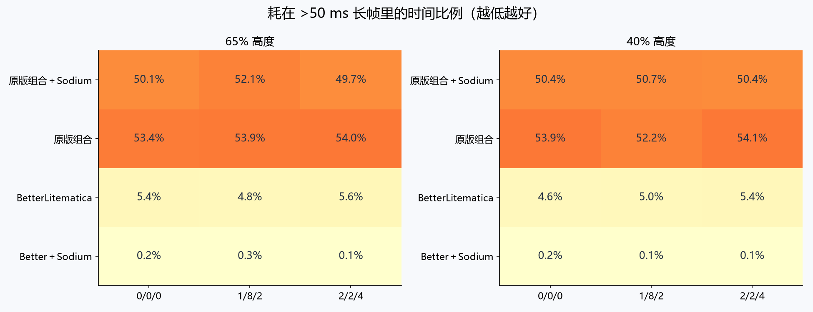
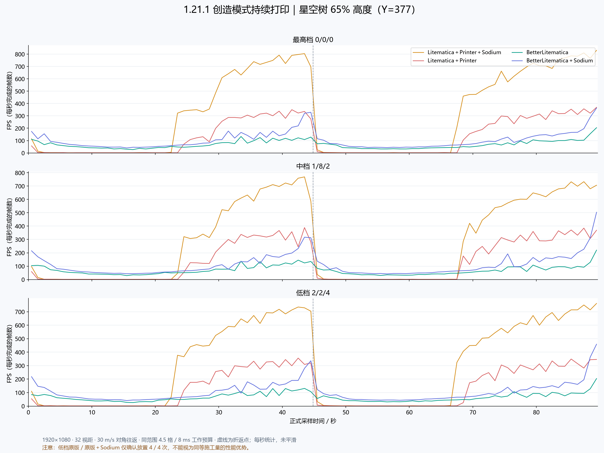
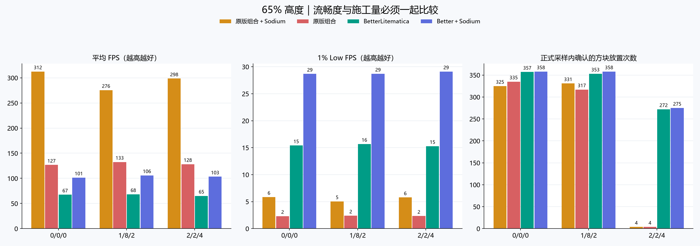
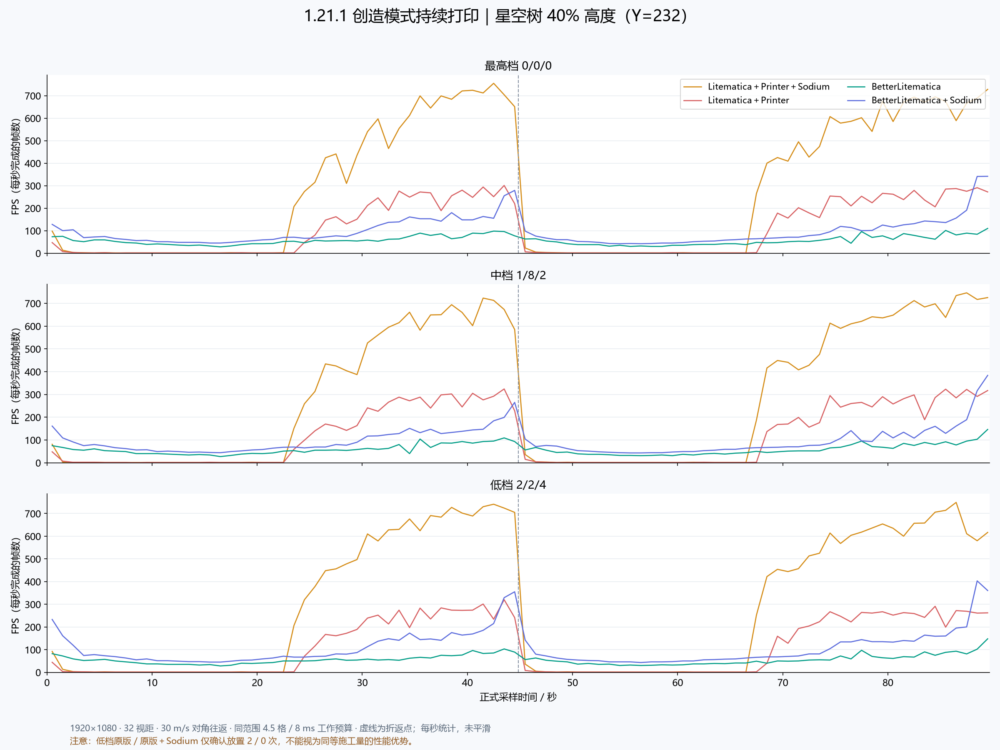
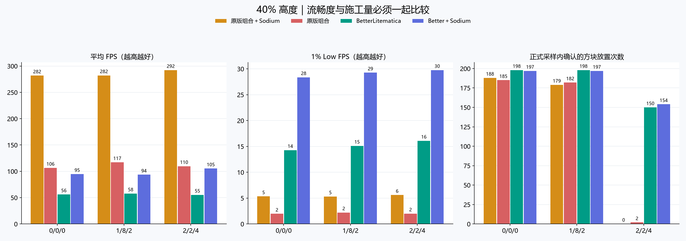

# Minecraft 1.21.1 持续打印性能对比

> 历史测试：被测 BetterLitematica 为 0.4.14。文中的“等待推广”描述当时进度；当前 0.4.17 已完成 31 版本源码推广和构建。
四种模组组合、三档打印参数、65% / 40% 两个高度，共 24 趟正式测试。每组每条件各一次，完整保留逐帧记录；短预检不计入结果。

## 本次结果

累计分析 308,256 个正式帧间隔，约 35.87 分钟正式采样；另外每趟均预热 90 秒。
原版组合的平均 FPS 更高，但大量时间耗在约 1 秒的长帧中；BetterLitematica 的平均 FPS 更低，长帧明显更少。此次路线中 BetterLitematica＋Sodium 的最慢 1% 帧与 >50 ms 长帧占时表现最好，不能据此宣称 Better 原生版已达到或超过 Sodium。
原版组的长停顿主要集中在每段路线前半程（约 2–24 秒、46–69 秒），随后 FPS 大幅升高。P99 按帧计数，容易被后续大量快帧掩盖；1% Low、最大帧时间和长帧占时必须一起看。

| 高度 | 组合（0/0/0） | 平均 FPS | 1% Low FPS | >50 ms 长帧占时 | 最大帧时间 |
|---|---|---:|---:|---:|---:|
| 65% | Litematica＋Printer＋Sodium | 312.5 | 5.8 | 50.10% | 1055.2 ms |
| 65% | Litematica＋Printer | 126.6 | 2.3 | 53.35% | 1178.4 ms |
| 65% | BetterLitematica | 67.4 | 15.4 | 5.38% | 277.7 ms |
| 65% | BetterLitematica＋Sodium | 101.4 | 28.7 | 0.22% | 71.3 ms |
| 40% | Litematica＋Printer＋Sodium | 281.9 | 5.3 | 50.41% | 1068.1 ms |
| 40% | Litematica＋Printer | 106.4 | 2.0 | 53.94% | 1127.4 ms |
| 40% | BetterLitematica | 56.0 | 14.3 | 4.61% | 267.5 ms |
| 40% | BetterLitematica＋Sodium | 94.7 | 28.4 | 0.19% | 63.9 ms |

三档对比：Better 两组的平均 FPS 未随降档稳定上升，说明不能仅靠降低打印速度期待整体帧率改善。低档确实减少了施工量；原版低档还出现了下文所述的高速移动施工异常。

这些结论只描述本机本场景的各一次实测。两套投影在起点截图中的显示密度和透明效果也存在差异，属于各自渲染实现的实际表现；这不是完全相同图元工作量的渲染微基准。

## 必须先看：低档原版的施工异常

在 30 m/s、2/2/4 参数下，两组原版的实际放置次数很低。这些样本保留原始帧率，但不能解释成同等施工量下的性能优势。
测试 JAR 的实现中，玩家移动达到工作半径的 40% 时会重建扫描区域并回到收集阶段。4.5 格半径的阈值约 1.8 格，而两 tick 间隔在 30 m/s 下约移动 3 格；因此扫描可能不断重置，来不及执行放置。此为与实测吻合的代码机制分析，未另行插桩记录每次内部状态转移。
第 22 趟（40% 高度、低档、原版＋Sodium）最终放置为 0，原始 result.json 的 passed=false 保持不变。该标记来自测试工具的“放置数量非零”条件，不能忽略。轨迹、前台、创造模式、打印开关、无碰撞和记录完整性均通过；分析将其归为有效采样中的施工失败。

## 测试条件

- 星空树：809 × 580 × 726；投影原点 (-404, 0, -363)。使用先前测试保留的同一文件，SHA-256：`b67e199f858f9f183460ca3d919bc8afaee357824827702729c3d000a1eb2295`。
- 路线：(-500, Y, -450) → (500, Y, 450) → 起点，视角沿移动方向、俯仰角 0°；30 m/s 按墙钟时间驱动，单趟约 89.69 秒。65% 高度 Y=377，40% 高度 Y=232。
- 每趟启动新进程、还原同一空白世界头和数据包；世界总高度 1024，随机刻为 0。沿途区块首次生成是本测试负载的一部分，未预生成整条路线。
- 1920×1080、视距 32、模拟距离 5、FOV 70、精美画质、关闭垂直同步与帧率上限、关闭云与视角晃动、最少粒子、无光影。
- 创造模式，只有打印施工模式开启；预热及正式往返全程开启。两者均为球形 4.5 格范围、8 ms 工作预算、允许空中放置；HUD、施工高亮和投影外框关闭，投影透明度 45%。
- 三档参数依次为放置间隔 tick / 每 tick 上限 / 同位置冷却 tick：最高 0/0/0、中档 1/8/2、低档 2/2/4。
- 四组使用同一外置测试模组：保留创造模式与正常相机高度，设置玩家 noClip、零体积碰撞箱，取消玩家对放置位置的阻挡；没有使用旁观者模式。
- 每趟预热 90 秒；四组执行顺序在不同高度/档位交错。只运行一个游戏实例，采样期间不构建、不抓取额外桌面画面；记录焦点和碰撞状态以校验有效性。
- Java 21.0.12.1，G1GC，-Xms2G -Xmx4G；Fabric Loader 0.19.5，Fabric API 0.116.17+1.21.1。
- 本机 CPU：13th Gen Intel(R) Core(TM) i5-13600KF；实际 OpenGL GPU：NVIDIA GeForce RTX 3080；物理内存约 31.8 GiB。

## 模组版本

| 模组 | 版本 |
|---|---|
| better | 0.4.14 |
| litematica | 0.19.61 |
| printer | 1.3-beta.4 |
| malilib | 0.21.10 |
| sodium | mc1.21.1-0.8.13-fabric |

原版打印机使用前次对照相同的 BiliXWhite / IMAX9D 系列 1.3-beta.4，取其原始版本包内的 1.21.1 JAR；未修改被测模组。每趟 manifest.json 记录完整文件校验和。

## 指标口径

- 帧时间是渲染循环相邻帧起点间隔，包含该循环的等待/卡顿；不是显卡或显示器的真实 Present 时间，不能据此计算输入延迟。
- 平均 FPS = 有效帧数 / 覆盖时间，未对瞬时 FPS 做算术平均。1% Low = 最慢 1% 帧的平均帧时间倒数。P99/P99.9 与最大值均以毫秒计，越低越好。
- 只排除跨入正式计时的边界间隔、计时范围外记录和非正间隔；不删除长帧、不裁掉尖峰。FPS 折线是每秒帧数，未平滑；逐帧图保留每一帧，使用统一对数纵轴。
- 放置次数：服务端确认的非空气方块类型写入，限定在路线高度上下 16 格；同时提供不重复位置数量。该值不是“完全正确且最终保留的投影方块数”，可能包含邻接/流体带来的类型变化。正式时段与之后 2 秒收尾数量分开。
- 服务端 tick 时间记录每次 tick 主体耗时，不包含等待下一个 tick 的空闲。GC 统计来自 JVM 累计计数差；结束快照在正式结束被客户端处理时取得，可能比严格截止时刻稍晚。
- movement 按实际时间推进：发生长帧时人物会在下一次客户端 tick 追上规定路线，因此会减少沿途的打印机会；这与固定移动速度的原方案一致。原始 CSV 保留位置、路线时间、视角及状态。

## 65% 高度

### 最高档 0/0/0

| 组合 | 平均 FPS | 1% Low | P99 / ms | P99.9 / ms | 最大 / ms | >50ms 帧数 | 放置次数 | 不重复位置 | 服务端 TPS |
|---|---:|---:|---:|---:|---:|---:|---:|---:|---:|
| Litematica＋Printer＋Sodium | 312.5 | 5.8 | 9.79 | 843.51 | 1055.19 | 77 | 325 | 325 | 19.99 |
| Litematica＋Printer | 126.6 | 2.3 | 29.10 | 996.04 | 1178.36 | 77 | 335 | 335 | 19.99 |
| BetterLitematica | 67.4 | 15.4 | 52.01 | 74.09 | 277.70 | 78 | 357 | 357 | 19.99 |
| BetterLitematica＋Sodium | 101.4 | 28.7 | 29.83 | 42.53 | 71.31 | 3 | 358 | 358 | 19.99 |

[逐帧时间图](charts/frametimes-65-high.png)

### 中档 1/8/2

| 组合 | 平均 FPS | 1% Low | P99 / ms | P99.9 / ms | 最大 / ms | >50ms 帧数 | 放置次数 | 不重复位置 | 服务端 TPS |
|---|---:|---:|---:|---:|---:|---:|---:|---:|---:|
| Litematica＋Printer＋Sodium | 275.5 | 5.0 | 10.17 | 885.37 | 1140.63 | 77 | 331 | 331 | 20.00 |
| Litematica＋Printer | 132.5 | 2.4 | 30.37 | 1005.19 | 1095.89 | 78 | 317 | 317 | 19.99 |
| BetterLitematica | 68.2 | 15.7 | 51.38 | 71.33 | 258.03 | 69 | 353 | 353 | 20.00 |
| BetterLitematica＋Sodium | 105.8 | 28.7 | 29.90 | 41.49 | 76.78 | 4 | 358 | 358 | 20.00 |

[逐帧时间图](charts/frametimes-65-medium.png)

### 低档 2/2/4

| 组合 | 平均 FPS | 1% Low | P99 / ms | P99.9 / ms | 最大 / ms | >50ms 帧数 | 放置次数 | 不重复位置 | 服务端 TPS |
|---|---:|---:|---:|---:|---:|---:|---:|---:|---:|
| Litematica＋Printer＋Sodium | 298.5 | 5.8 | 5.37 | 852.48 | 1117.17 | 80 | 4 | 4 | 20.00 |
| Litematica＋Printer | 128.2 | 2.3 | 25.78 | 996.63 | 1147.57 | 83 | 4 | 4 | 20.00 |
| BetterLitematica | 65.1 | 15.3 | 53.87 | 77.63 | 113.23 | 81 | 272 | 272 | 19.99 |
| BetterLitematica＋Sodium | 103.3 | 29.1 | 29.74 | 41.16 | 56.64 | 2 | 275 | 275 | 19.99 |

[逐帧时间图](charts/frametimes-65-low.png)

## 40% 高度

### 最高档 0/0/0

| 组合 | 平均 FPS | 1% Low | P99 / ms | P99.9 / ms | 最大 / ms | >50ms 帧数 | 放置次数 | 不重复位置 | 服务端 TPS |
|---|---:|---:|---:|---:|---:|---:|---:|---:|---:|
| Litematica＋Printer＋Sodium | 281.9 | 5.3 | 7.17 | 873.39 | 1068.07 | 76 | 188 | 188 | 19.99 |
| Litematica＋Printer | 106.4 | 2.0 | 37.70 | 1018.98 | 1127.36 | 80 | 185 | 185 | 19.99 |
| BetterLitematica | 56.0 | 14.3 | 52.52 | 75.63 | 267.50 | 62 | 198 | 198 | 20.00 |
| BetterLitematica＋Sodium | 94.7 | 28.4 | 30.19 | 43.17 | 63.95 | 3 | 197 | 197 | 19.99 |

[逐帧时间图](charts/frametimes-40-high.png)

### 中档 1/8/2

| 组合 | 平均 FPS | 1% Low | P99 / ms | P99.9 / ms | 最大 / ms | >50ms 帧数 | 放置次数 | 不重复位置 | 服务端 TPS |
|---|---:|---:|---:|---:|---:|---:|---:|---:|---:|
| Litematica＋Printer＋Sodium | 282.2 | 5.3 | 6.80 | 874.86 | 1083.30 | 70 | 179 | 179 | 19.99 |
| Litematica＋Printer | 117.1 | 2.2 | 33.54 | 1008.17 | 1130.74 | 79 | 182 | 182 | 20.00 |
| BetterLitematica | 57.8 | 15.1 | 53.40 | 74.02 | 272.03 | 72 | 198 | 198 | 19.99 |
| BetterLitematica＋Sodium | 93.5 | 29.3 | 29.93 | 39.91 | 68.51 | 2 | 197 | 197 | 20.00 |

[逐帧时间图](charts/frametimes-40-medium.png)

### 低档 2/2/4

| 组合 | 平均 FPS | 1% Low | P99 / ms | P99.9 / ms | 最大 / ms | >50ms 帧数 | 放置次数 | 不重复位置 | 服务端 TPS |
|---|---:|---:|---:|---:|---:|---:|---:|---:|---:|
| Litematica＋Printer＋Sodium | 292.3 | 5.6 | 5.59 | 861.20 | 1078.40 | 76 | 0 | 0 | 19.99 |
| Litematica＋Printer | 109.7 | 2.0 | 33.13 | 1033.21 | 1120.67 | 74 | 2 | 2 | 20.00 |
| BetterLitematica | 55.2 | 16.1 | 54.43 | 73.54 | 83.83 | 84 | 150 | 150 | 20.00 |
| BetterLitematica＋Sodium | 105.3 | 29.8 | 29.43 | 40.25 | 79.49 | 1 | 154 | 154 | 20.00 |

[逐帧时间图](charts/frametimes-40-low.png)

## 数据完整性与解读边界

- 24 趟均通过打印开关持续开启、创造模式、前台焦点、零碰撞箱、固定高度与轨迹检查。这里的采样质量通过不代表施工功能通过，特别是第 22 趟零放置失败；正式结果不混入启动预检。
- 每条件只有一趟，组间数值用于本机此次场景对照；没有重复试验的置信区间，不能直接推广为所有机器或所有投影的性能排名。
- 渲染实现、流式加载范围与内部剔除算法本身是被测差异；没有为追求某一结果改动任一模组。默认内部设置差异和帧率需结合放置次数、中央区域帧时间及投影构建记录一起解读。
- BetterLitematica 的部分运行记录存在水体模型被跳过的提示，逐趟列在 render-warnings.json；不能把两套投影视为逐像素相同的渲染工作量。
- GPU 驱动版本为 32.0.16.1692。Sodium 两组自动启用了 NVIDIA_THREADED_OPTIMIZATIONS_BROKEN 兼容处理，保持其默认行为。
- 非游戏后台程序保持原状；显卡温度、时钟和占用采样见 gpu-summary.csv / gpu.csv。未将操作系统调成专用实验环境。
- 中段（|X|≤250）、去程和返程统计在 segments.csv；完整汇总 summary.csv，逐秒统计 per-second.csv，各组差值 comparisons.csv。

## 原始数据

每趟目录保存 frames.csv、server-ticks.csv、samples.csv、result.json、validation.json、manifest.json、投影构建状态、开始/结束截图及游戏日志。driver 目录是四组共用的测试与无碰撞工具源码，不会安装到用户常用实例。
