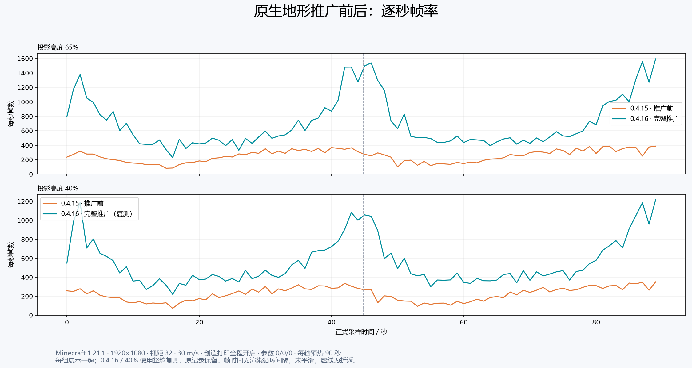
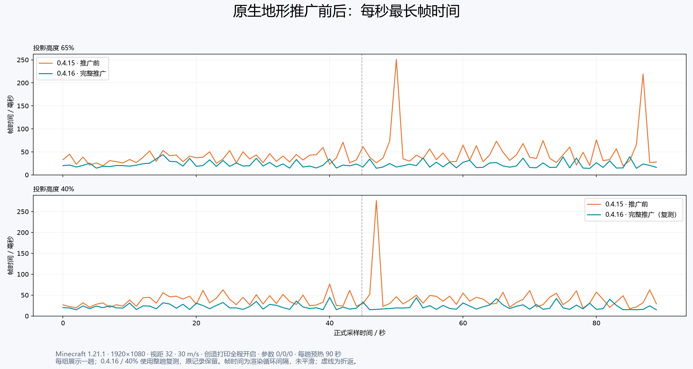
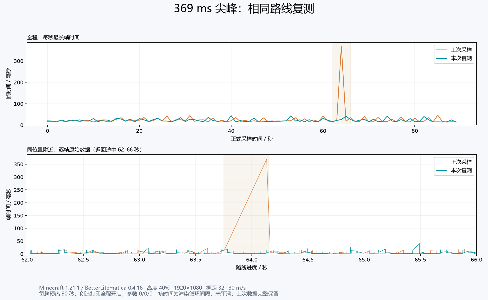

# 0.4.16 全版本原生地形推广验收

这次覆盖全部 31 个游戏版本的投影与原生地形优化。0.4.15 只完成了投影部分；0.4.16 补齐原生地形线程、可见区段遍历、保守视锥缓存、区域合批、上传预算和过期结果保护。

## 实现范围

| 版本 | 地形绘制适配 |
| --- | --- |
| 1.18.1–1.21.4 | 区域顶点／索引页、原生 OpenGL 多段绘制、分段上传、显卡同步后回收 |
| 1.21.5–1.21.11 | 游戏 GPU 缓冲接口中的区域子分配；共享区域坐标；实际 `glMultiDrawElements` 合批，保留透明顺序和区段淡入 |
| 26.1–26.3 | 复用游戏新增的共享缓冲和合批后端，接入专用线程、六面连通遍历、视锥缓存、上传预算及失效结果保护 |

所有版本都保留原版模型、流体、光照与着色器语义。没有打包 Sodium。检测到 Sodium、Iris、Canvas、VulkanMod 或 OptiFabric 时，整组原生地形 Mixin 一起跳过，投影优化保留。

## 构建与运行验收

- 31 个目标全部构建通过，使用 `targets.json` 中原有的 Loader／Fabric API 依赖下限。运行验证使用 Loader 0.19.5，部分 Fabric API 高于构建下限，不能据此声称每个依赖下限组合都已实测。
- 核心回归：138 项、2,513,945 条断言。每个目标检查实际采用的源码、注册的地形钩子、真实游戏字节码中的成员与注入位置。故意移除可见区段遍历钩子的负例被构建检查拒绝。
- 31 个独立客户端均验证后台模型快照、投影渲染、分层、旋转／镜像、卸载、12 格创造打印，以及原生地形线程、共享页、实际绘制与遍历。模型抽样比对合计 2,997,316 次。
- 每个客户端覆盖七个观察位置、远距离离开再返回、实体地形修改和渲染器重载；检查地形页释放，最终正常退出。26.2／26.3 在断开世界后调用游戏的渲染数据重置 API 验证释放；这不是声称新版原版游戏仅断开连接便立即释放全部缓存。
- 1.21.5–1.21.11 除了检查绘制发生，还检查真实批量绘制调用数小于绘制区段数，避免把逐条执行的集合接口误当作合批。
- 1.20.1 + Sodium 0.5.13、1.21.1 + Sodium 0.8.13 通过运行验证；检查原生遍历 Mixin 未加载，投影、打印仍正常。Iris、Canvas、VulkanMod、OptiFabric 仅检查跳过逻辑，未做完整运行验收。
- 各运行记录绑定到最终 JAR 的 SHA-256；仅显示相同版本号而文件不同，不计为验收通过。

| Minecraft | 模型抽样比对次数 | 打印 | 地形后台线程 |
| --- | ---: | --- | ---: |
| 1.18.1 | 71,428 | 12 / 12 | 6 |
| 1.18.2 | 71,428 | 12 / 12 | 6 |
| 1.19 | 74,844 | 12 / 12 | 6 |
| 1.19.1 | 74,844 | 12 / 12 | 6 |
| 1.19.2 | 74,844 | 12 / 12 | 6 |
| 1.19.3 | 76,804 | 12 / 12 | 6 |
| 1.19.4 | 79,072 | 12 / 12 | 6 |
| 1.20 | 79,632 | 12 / 12 | 6 |
| 1.20.1 | 79,632 | 12 / 12 | 6 |
| 1.20.2 | 79,632 | 12 / 12 | 6 |
| 1.20.3 | 85,848 | 12 / 12 | 6 |
| 1.20.4 | 85,848 | 12 / 12 | 6 |
| 1.20.5 | 86,072 | 12 / 12 | 6 |
| 1.20.6 | 86,072 | 12 / 12 | 6 |
| 1.21 | 86,072 | 12 / 12 | 6 |
| 1.21.1 | 86,072 | 12 / 12 | 6 |
| 1.21.2 | 88,340 | 12 / 12 | 6 |
| 1.21.3 | 88,340 | 12 / 12 | 6 |
| 1.21.4 | 110,376 | 12 / 12 | 6 |
| 1.21.5 | 110,992 | 12 / 12 | 6 |
| 1.21.6 | 111,160 | 12 / 12 | 6 |
| 1.21.7 | 111,160 | 12 / 12 | 6 |
| 1.21.8 | 111,160 | 12 / 12 | 6 |
| 1.21.9 | 120,764 | 12 / 12 | 6 |
| 1.21.10 | 120,764 | 12 / 12 | 6 |
| 1.21.11 | 120,764 | 12 / 12 | 6 |
| 26.1 | 120,820 | 12 / 12 | 6 |
| 26.1.1 | 120,820 | 12 / 12 | 6 |
| 26.1.2 | 120,820 | 12 / 12 | 6 |
| 26.2 | 124,376 | 12 / 12 | 6 |
| 26.3 | 138,516 | 12 / 12 | 6 |

## 画面对照

选取 1.18.1、1.21.1、1.21.5、1.21.11、26.1、26.3，每个版本分别开启／关闭原生地形优化。两组使用相同画面设置，固定模型与位置，树叶设为持久状态；包含悬空箱子所在的纯方块实体区段、玻璃与水、洞穴、开洞后的更新和重载。共 12 趟、108 张截图，形成 54 对画面。

下表列出原始像素差，颜色通道范围 0–255。动态水纹、云层与光照闪烁会造成像素差，数值本身不能替代几何检查；人工检查配对画面中是否出现结构缺失、错位和透明顺序变化。

| 版本 | 配对画面 | 平均通道差 | 单张最大差异像素比例（差值 > 32） |
| --- | ---: | ---: | ---: |
| 1.18.1 | 9 | 0.3200 | 1.2831% |
| 1.21.1 | 9 | 0.0136 | 0.0002% |
| 1.21.5 | 9 | 0.0345 | 0.0005% |
| 1.21.11 | 9 | 0.0665 | 0.0179% |
| 26.1 | 9 | 0.0096 | 0.0000% |
| 26.3 | 9 | 0.0123 | 0.0000% |

## 验证中修正的问题

- 旧版本与新版本对区段包装接口的要求不同，修正了不能作为普通类 Mixin 使用的接口默认方法。
- 保留替换原版地形入口时的实体渲染距离与相机区段重定位副作用。
- 1.21.11 的资源覆盖层一度覆盖了新版投影生命周期入口；移除冗余覆盖层并增加注册检查，实际绘制与打印已复测通过。
- 26.3 验收启动器遗漏官方 JVM 参数时发生 `jvm.dll / 0xc0000005`。补齐 `StackShadowPages=32`、内部接口导出、原生访问与独立原生库缓存目录后通过。本次没有限制 CPU 数量或关闭 JIT；没有更改用户常用实例。官方参数来源为 [Minecraft 26.3 元数据](https://piston-meta.mojang.com/v1/packages/11f1aefe473eefba0af62e3286c33b692807b2eb/26.3.json)。
- 外部测试驱动的飞行固定、退出流程与辅助类打包错误均单独修正；失败记录保留，不计入通过数量。测试驱动不会进入正式 JAR。

## 性能边界

运行验收主要证明功能接入与渲染正确性。所有版本均有优化实现，不代表所有版本具有相同 FPS，也不能据此宣称超过 Sodium。代表版本的逐帧路线复测见下方；其他版本尚无本轮同条件性能数字。

### 1.21.1 星空树路线复测

0.4.15 与 0.4.16 各测 65%／40% 高度。1920×1080、32 视距、模拟距离 5、FOV 70，30 m/s 沿对角线往返，创造模式打印全程开启，参数 0/0/0、范围 4.5、扫描预算 8 ms。每趟新世界、预热 90 秒、正式采样约 89.69 秒，玩家碰撞箱为零；两组使用相同测试驱动与投影。全部正式帧检查前台焦点、打印开启、创造模式和路线坐标。

表格每组展示一趟完整采样。按用户要求，0.4.16 的 40% 高度组采用 2026-10-25 的有效复测整趟数据，其余三组仍采用原采样；汇总、逐秒曲线和原始数据包使用相同选择，不拼接片段或删除单帧。该组首次采样及旧汇总已保留，复测对照见下方。帧时间为渲染循环间隔，不是显示器实际呈现时间；逐秒最长帧按间隔终点归组。1% low 取最慢 1% 帧的平均帧时间倒数。当前表格不是全部有效运行的合并统计，不能估计长期波动或统计置信区间。

| 高度 | 版本 | 平均 FPS | 1% low FPS | P99 / ms | 最长帧 / ms | >50 ms 帧数 | 实际放置 |
| --- | --- | ---: | ---: | ---: | ---: | ---: | ---: |
| 65% | 0.4.15 | 251.56 | 28.50 | 22.24 | 250.83 | 24 | 357 |
| 65% | 0.4.16 | 701.86 | 67.37 | 10.27 | 43.94 | 0 | 355 |
| 40% | 0.4.15 | 221.76 | 29.11 | 22.47 | 276.26 | 19 | 195 |
| 40% | 0.4.16（复测） | 549.35 | 61.35 | 11.89 | 44.50 | 0 | 199 |

当前选用的两对结果中，平均帧率和低帧均改善，超过 50 ms 的长帧从 24 / 19 次降至 0 / 0 次。40% 高度复测的最长帧为 44.50 ms，首次采样的 369.38 ms 在同位置及附近路段未复现，暂记为单次偶发尖峰；首次记录仍保留于下方对照和原始数据包的 reference-original-runs 目录中。打印数量相近但并非完全相同，时序变化和服务器确认会影响有效放置次数，不能把全部帧率差异都归结为绘制调用数。

[汇总数据](summary.csv) · [逐秒数据](per-second.csv) · [采样选择说明](report-selection.json)

### 369 ms 尖峰的同位置复测

2026-10-25，以完全相同的 0.4.16 JAR、驱动、初始世界、投影和设置，再完成一趟 40% 高度路线。预热 90 秒，正式采样 89.69 秒，共 49,269 有效帧，全部条件检查通过。未修改代码。

| 指标 | 原采样 | 本次复测 |
| --- | ---: | ---: |
| 原位置最长帧（返回路线 63.75–64.15 秒） | 369.38 ms | 17.18 ms |
| 附近路段最长帧（返回路线 62–66 秒） | 369.38 ms | 41.31 ms |
| 全程最长帧 | 369.38 ms | 44.50 ms |
| >50 ms 帧数 | 1 | 0 |
| 平均 FPS | 555.68 | 549.35 |
| 1% low FPS | 58.69 | 61.35 |
| P99 / ms | 11.90 | 11.89 |
| 实际放置 | 196 | 199 |

同位置及附近路段均未复现 369 ms，支持暂记为单次偶发尖峰，尚不能据一次复测排除低频长帧。原记录完整保留，旧汇总存入历史归档；上方主表与主图已改用本次整趟复测，未删除原采样中的单帧。前两次启动因失焦导致打印机在预热期暂停，没有正式样本，已排除并保留失败记录；第三次提前保持前台后完成标准流程。

[复测汇总与位置](spike-repeat-summary.json) · [复测每秒数据](spike-repeat-per-second.csv)
